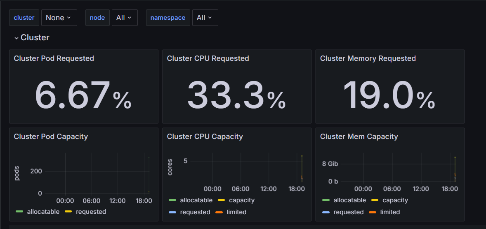

<div align="center">

# OVERWATCH

### Kubernetes monitoring, alerting and FinOps on AWS

See what is happening. Get alerted when it breaks. Know what it costs.
One `terraform apply` builds it. Every `git push` updates it.

[](https://github.com/Shubhamx18/overwatch/actions/workflows/deploy.yml)




</div>

---

## Contents

1. [Overview](#1-overview)
2. [Quick Start](#2-quick-start)
3. [How It Works](#3-how-it-works)
4. [Credentials](#4-credentials)
5. [Setup](#5-setup)
6. [Verify](#6-verify)
7. [Screenshots](#7-screenshots)
8. [FinOps](#8-finops)
9. [CI/CD](#9-cicd)
10. [Operations](#10-operations)
11. [Troubleshooting](#11-troubleshooting)
12. [Security](#12-security)
13. [Design Notes](#13-design-notes)
14. [Project Structure](#14-project-structure)
15. [Roadmap](#15-roadmap)

---

## 1. Overview

Overwatch is a monitoring stack that runs on a Kubernetes ([kind](https://kind.sigs.k8s.io/)) cluster on one AWS EC2 server. It answers three questions:

| Question | Answered by | Where |
|---|---|---|
| Is my cluster healthy? | Prometheus metrics | Grafana dashboards |
| Will I know when something breaks? | Alertmanager | Alertmanager UI |
| What is this costing me? | FinOps recording rules | FinOps dashboard |

Everything is code: **Terraform** builds the server, **Kubernetes manifests** define the stack, and **GitHub Actions** tests and deploys every push to `main`.

| | |
|---|---|
| **Setup time** | About 30 minutes |
| **Runs on** | One EC2 `t3.medium` in `ap-south-1` (Mumbai) |
| **You need** | An AWS account, a GitHub account, a terminal |
| **Cost** | EC2 is billed by the hour. Run `terraform destroy` when done |

---

## 2. Quick Start

Already have an AWS access key, an EC2 key pair in `ap-south-1`, and Git, Terraform and the AWS CLI installed?

```bash
aws configure                    # your keys, region: ap-south-1
git clone https://github.com/Shubhamx18/overwatch.git
cd overwatch/terraform-aws/prometheus-stack

# edit terraform.tfvars  ->  key_name = "your-key-pair-name"

terraform init
terraform apply                  # type "yes"
```

After about 5 minutes, open `http://<ec2_public_ip>:3000`.

New to any of this? Follow the [full setup](#5-setup).

---

## 3. How It Works

| Component | Job |
|---|---|
| **Node Exporter** | Reports CPU, RAM, disk and network of each node |
| **kube-state-metrics** | Reports the state of pods and nodes |
| **Blackbox Exporter** | Probes URLs for uptime and SSL expiry |
| **Prometheus** | Collects metrics, evaluates alert and recording rules |
| **Grafana** | Draws dashboards from Prometheus |
| **Alertmanager** | Groups, routes and sends alerts |

**The flow:** exporters publish metrics, Prometheus collects them, Grafana shows them, and Alertmanager handles alerts when a rule fires.

**The build:** Terraform creates the EC2 server and firewall. On first boot, the server installs Docker, kind and kubectl, clones this repo, creates the cluster and deploys everything. After that, GitHub Actions redeploys on every push.

> [!NOTE]
> The kind nodes are Docker containers on the same EC2 machine, so every Node Exporter reports the same underlying host. Near-identical numbers across nodes are expected.

---

## 4. Credentials

### 4.1 Everything you need to create

| Name | What it is | Where to get it | Where it goes | Secret |
|---|---|---|---|:---:|
| **AWS Access Key ID** | AWS username | IAM → Users → *your user* → Security credentials → Create access key | `aws configure` and GitHub secret `AWS_ACCESS_KEY_ID` | Private |
| **AWS Secret Access Key** | AWS password | Same screen (shown once) | `aws configure` and GitHub secret `AWS_SECRET_ACCESS_KEY` | Yes |
| **AWS Region** | Where it is built | Fixed: `ap-south-1` | `aws configure` | No |
| **Key pair name** | Label of your SSH key | EC2 → Key Pairs → Create key pair | `key_name` in `terraform.tfvars` | No |
| **Key pair file (`.pem`)** | SSH private key (downloaded once) | Created with the key pair | Your computer and GitHub secret `PROD_SSH_KEY` | Yes |
| **EC2 public IP** | Your server's address | `terraform output ec2_public_ip` | GitHub secret `PROD_SERVER_IP` | No |
| **Grafana login** | Dashboard username and password | Grafana manifest under `k8s/grafana/` | Used at `http://<EC2-IP>:3000`. Change it on first login | Yes |
| **GitHub environment** | Named deployment target | Settings → Environments → New environment | Name it `production` | No |

The EC2 server stores no secrets. It has no IAM role, and your AWS keys stay on your computer and in GitHub.

### 4.2 GitHub secrets

Only needed for [CI/CD](#9-cicd). Add them under **Settings → Secrets and variables → Actions → New repository secret**.

| Secret name | Value | How to get it |
|---|---|---|
| `AWS_ACCESS_KEY_ID` | Access key ID, like `AKIA...` | Saved when you created the key |
| `AWS_SECRET_ACCESS_KEY` | Secret access key | Saved when you created the key |
| `PROD_SSH_KEY` | The whole `.pem` file, including `-----BEGIN` and `-----END` lines | `cat overwatch-key.pem` (Mac/Linux) or `Get-Content .\overwatch-key.pem` (PowerShell) |
| `PROD_SERVER_IP` | Server public IP, like `3.110.113.96` | `terraform output ec2_public_ip` |

Also create the environment: **Settings → Environments → New environment → `production`**.

### 4.3 Keep secrets out of Git

Add this to `.gitignore` before your first commit:

```gitignore
*.pem
.env
*.tfstate
*.tfstate.*
.terraform/
```

> [!IMPORTANT]
> If a key leaks: IAM → Users → Security credentials → delete the key → create a new one → update `aws configure` and both GitHub secrets.

---

## 5. Setup

Each step ends with a **Check**. Fix any failure before moving on.

### Step 1: Install tools (10 min)

| Tool | Get it | Check with |
|---|---|---|
| Git | https://git-scm.com/downloads | `git --version` |
| Terraform | https://developer.hashicorp.com/terraform/install | `terraform -version` |
| AWS CLI v2 | https://aws.amazon.com/cli/ | `aws --version` |

**Check:** all three print a version.

### Step 2: Prepare AWS (10 min)

**Create an access key**

1. Go to **IAM → Users → Create user**.
2. Attach the policy `AmazonEC2FullAccess` (enough for a demo).
3. Open the user → **Security credentials → Create access key** → choose **CLI**.
4. Copy the Access Key ID and Secret Access Key now. The secret is shown once.

**Create a key pair**

1. Switch the console region to **Asia Pacific (Mumbai) `ap-south-1`**.
2. Go to **EC2 → Key Pairs → Create key pair**. Name it (for example `overwatch-key`), choose **RSA** and **.pem**.
3. Save the file, then lock it:

```bash
# macOS / Linux
chmod 400 overwatch-key.pem
```

```powershell
# Windows PowerShell
icacls .\overwatch-key.pem /inheritance:r /grant:r "$($env:USERNAME):R"
```

> [!WARNING]
> Key pairs are regional. A key made outside `ap-south-1` will not work.

**Confirm a default VPC exists:** **VPC → Your VPCs** should show one with **Default VPC: Yes**. If not, use **Actions → Create default VPC**.

**Check:** you have an access key, a `.pem` file and a default VPC.

### Step 3: Connect to AWS (1 min)

```bash
aws configure
```

| Prompt | Value |
|---|---|
| AWS Access Key ID | your access key ID |
| AWS Secret Access Key | your secret access key |
| Default region name | `ap-south-1` |
| Default output format | `json` |

Keys are saved in `~/.aws/credentials` (Windows: `C:\Users\<you>\.aws\credentials`).

```bash
aws sts get-caller-identity
```

**Check:** it prints your account ID and user ARN.

### Step 4: Get the code (1 min)

```bash
git clone https://github.com/Shubhamx18/overwatch.git
cd overwatch
```

Edit `terraform-aws/prometheus-stack/terraform.tfvars` and set your key pair name (no `.pem`):

```hcl
key_name = "overwatch-key"
```

> [!NOTE]
> **Using a fork?** The boot script clones the repo itself. Change the repo URL in the user-data script under `terraform-aws/modules/ec2/` so the server pulls your fork.

### Step 5: Build the server (3 min)

```bash
cd terraform-aws/prometheus-stack
terraform init
terraform plan       # optional preview
terraform apply      # type "yes"
```

This creates one EC2 `t3.medium` instance and a security group opening ports `22`, `3000`, `9090`, `9093` and `9115`. It prints:

```
ec2_public_ip = "X.X.X.X"
grafana_url   = "http://X.X.X.X:3000"
ssh_command   = "ssh -i <key>.pem ubuntu@X.X.X.X"
```

> [!IMPORTANT]
> Save the IP. Keep `terraform.tfstate`: without it, Terraform cannot manage or destroy your server.

**Check:** the EC2 console shows the instance **Running**.

### Step 6: Wait for first boot (5 min)

The server sets itself up: installs Docker, kind and kubectl, clones the repo, creates the cluster and deploys the stack. Watch progress:

```bash
ssh -i overwatch-key.pem ubuntu@<EC2-IP> "tail -f /var/log/monitoring-setup.log"
```

Then check the pods:

```bash
ssh -i overwatch-key.pem ubuntu@<EC2-IP> \
  "export KUBECONFIG=/home/ubuntu/.kube/config && kubectl get pods -n monitoring"
```

**Check:** 8 pods `Running` (alertmanager, blackbox-exporter, grafana, kube-state-metrics, prometheus, and one node-exporter per node).

### Step 7: Open the tools (1 min)

Use `http://`, not `https://`.

| Tool | URL | Look for |
|---|---|---|
| Grafana | `http://<EC2-IP>:3000` | Dashboards |
| Prometheus | `http://<EC2-IP>:9090` | `/targets` all **UP** |
| Alertmanager | `http://<EC2-IP>:9093` | Status **ready** |
| Blackbox Exporter | `http://<EC2-IP>:9115` | Probe results |

### Step 8: Log in to Grafana (3 min)

1. Log in with the credentials from the Grafana manifest under `k8s/grafana/`.
2. Change the password: profile icon → **Profile → Change password**.
3. Open **Dashboards**. **FinOps: Cost Intelligence** and **Node Exporter** are already loaded.

<details>
<summary>Optional: import community dashboards</summary>

<br>

**Dashboards → New → Import**, enter the ID, click **Load**, pick the **Prometheus** data source.

| ID | Dashboard |
|---|---|
| `1860` | Node Exporter Full |
| `7249` | Kubernetes Cluster |
| `13332` | kube-state-metrics |

</details>

> [!TIP]
> "No data"? Pick a value in the dropdowns at the top (Job, Instance, Nodename). The Node Exporter screenshots use **Job: `kubernetes-pods`**. `cluster: None` is normal for a single cluster.

**Check:** the FinOps dashboard shows live numbers.

### Step 9: Auto-deploy with CI/CD (optional, 5 min)

1. Fork this repo, or push your copy to a new GitHub repo.
2. Add the four [GitHub secrets](#42-github-secrets) and the `production` environment.
3. Push a change:

```bash
git add .
git commit -m "first pipeline run"
git push origin main
```

**Check:** the **Actions** tab shows three green stages.

### Step 10: Lock it down

Work through the [Security checklist](#12-security) before leaving it running.

---

## 6. Verify

| Check | How | Expected |
|---|---|---|
| Server up | EC2 console | **Running** |
| Pods healthy | `kubectl get pods -n monitoring` | 8 pods `Running` |
| Metrics flowing | Prometheus → Status → Targets | All **UP** |
| Dashboards alive | Grafana → Dashboards | Data in FinOps and Node Exporter |
| Alerting ready | Alertmanager → Status | **ready** |
| Pipeline works | GitHub → Actions | Three green stages |

**Send a test alert:**

```bash
curl -XPOST http://<EC2-IP>:9093/api/v2/alerts \
  -H 'Content-Type: application/json' \
  -d '[{"labels":{"alertname":"TestAlert","severity":"warning"}}]'
```

`TestAlert` should appear in Alertmanager. Until you add a receiver (Slack or email, see the [roadmap](#15-roadmap)), alerts show only in the UI.

---

## 7. Screenshots

**AWS EC2.** A `t3.medium` in `ap-south-1`. Everything runs on this one machine.


**Alertmanager.** Status `ready`. Prometheus sends alerts here.


**Cluster overview.** How much pod, CPU and memory capacity is already requested. The starting point for right-sizing.


**Node view.** CPU busy, system load, RAM and swap used, pressure, uptime.


**Resource utilization.** Load, memory, disk I/O and the most memory-hungry pods over time.


**Pod and node health.** Running pods, restarts, CPU idle and node storage.


---

## 8. FinOps

Prometheus recording rules pre-compute these metrics every 15 seconds, so dashboards load instantly.

> **Low utilization with steady cost means over-provisioned.** That gap is where the savings are.

| Metric | Meaning |
|---|---|
| `finops:cpu_utilization_24h` | Current CPU usage % |
| `finops:ram_utilization_24h` | Current RAM usage % |
| `finops:disk_utilization` | Current disk usage % |
| `finops:total_ram_gb` | Total RAM in GB |
| `finops:ec2_hourly_cost_usd` | EC2 cost per hour (t3.medium, ap-south-1) |
| `finops:ec2_session_cost_usd` | Cost since the instance booted |
| `finops:ec2_daily_cost_usd` | Projected daily cost |
| `finops:ec2_monthly_cost_usd` | Projected monthly cost |

> [!NOTE]
> Cost uses a fixed hourly price for `t3.medium` in `ap-south-1`. If you change the instance type or region, update the price in the recording rules under `k8s/prometheus/`.

---

## 9. CI/CD

Every push to `main` runs three stages (`.github/workflows/deploy.yml`):

| Stage | What it does | Time |
|---|---|---|
| **1. Validate** | Checks every manifest with `kubeconform` | ~1 min |
| **2. Integration test** | Deploys everything to a temporary kind cluster and checks that Prometheus and Grafana are healthy | ~5 min |
| **3. Deploy** | SSHes into EC2, runs `git pull` and `kubectl apply --server-side` | ~1 min |

If a stage fails, the pipeline stops and nothing reaches your server.

Secrets used: `AWS_ACCESS_KEY_ID`, `AWS_SECRET_ACCESS_KEY`, `PROD_SSH_KEY`, `PROD_SERVER_IP`, plus the `production` environment ([details](#42-github-secrets)).

### After a Prometheus config change

Prometheus reads its config only at startup. Restart it to load new rules and scrape configs:

```bash
ssh -i <key>.pem ubuntu@<EC2-IP> \
  "export KUBECONFIG=/home/ubuntu/.kube/config && \
   kubectl rollout restart deployment prometheus grafana -n monitoring"
```

---

## 10. Operations

| I want to... | Run |
|---|---|
| SSH into the server | `ssh -i <key>.pem ubuntu@<EC2-IP>` |
| Check pods | `kubectl get pods -n monitoring` |
| See scrape targets | `http://<EC2-IP>:9090/targets` |
| Watch the boot log | `tail -f /var/log/monitoring-setup.log` |
| Deploy a change | `git push origin main` |
| Get the server IP | `terraform output ec2_public_ip` |
| Restart Prometheus | `kubectl rollout restart deployment prometheus -n monitoring` |

**IP changed after a stop/start?** Public IPs change on every restart. Run `terraform output ec2_public_ip`, then update the `PROD_SERVER_IP` secret. For a permanent address, attach an **Elastic IP** (AWS charges for public IPv4 addresses).

**Stop paying:**

```bash
cd terraform-aws/prometheus-stack
terraform destroy      # type "yes"
terraform apply        # to bring it back, then wait ~5 minutes
```

> [!WARNING]
> A running EC2 instance is billed by the hour. After `terraform destroy`, confirm in the EC2 console that nothing is still running.

---

## 11. Troubleshooting

<details>
<summary><b>During setup</b></summary>

<br>

| Symptom | Cause and fix |
|---|---|
| `aws sts get-caller-identity` fails | Wrong keys. Run `aws configure` again |
| `InvalidKeyPair.NotFound` | `key_name` misspelled, includes `.pem`, or the key is not in `ap-south-1` |
| `UnauthorizedOperation` | IAM user lacks EC2 permissions. Attach `AmazonEC2FullAccess` |
| No VPC or subnet found | No default VPC. VPC console → Actions → Create default VPC |
| `ssh`: `Permission denied (publickey)` | Wrong key, wrong user (use `ubuntu`), or loose permissions (`chmod 400`) |
| `ssh` times out | Instance still starting, IP changed, or port 22 blocked |

</details>

<details>
<summary><b>After setup</b></summary>

<br>

| Symptom | Cause and fix |
|---|---|
| `ERR_CONNECTION_TIMED_OUT` | IP changed, a security group rule is missing, you used `https://`, or the boot script is still running |
| Pods not ready | Check the boot log. Pods stuck `Pending` can mean the t3.medium is out of memory |
| Prometheus targets show 403 | Apply `k8s/prometheus/kubelet-rbac.yaml` |
| Grafana "No data" | Check the dropdowns, and confirm the target is **UP** in Prometheus |
| Config change not showing | Restart Prometheus and Grafana ([how](#after-a-prometheus-config-change)) |

</details>

<details>
<summary><b>CI/CD</b></summary>

<br>

| Symptom | Cause and fix |
|---|---|
| `Permission denied (publickey)` | `PROD_SSH_KEY` is incomplete. Paste the whole file, including `BEGIN` and `END` lines |
| Deploy cannot connect | `PROD_SERVER_IP` is outdated, or port 22 blocks GitHub's runners ([why](#12-security)) |

</details>

---

## 12. Security

| Port | Service | Login |
|---|---|:---:|
| 22 | SSH | Key only |
| 3000 | Grafana | Yes |
| 9090 | Prometheus | **No** |
| 9093 | Alertmanager | **No** |
| 9115 | Blackbox Exporter | **No** |

By default all ports accept traffic from anywhere (`0.0.0.0/0`). That is fine for a demo, not for production.

- [ ] Change the Grafana password after first login
- [ ] Restrict ports 9090, 9093 and 9115 to your own IP (`curl ifconfig.io`)
- [ ] Never commit `.pem`, AWS keys, `.env` or Terraform state ([see 4.3](#43-keep-secrets-out-of-git))
- [ ] Use a dedicated IAM user with limited permissions, and rotate its keys

> [!WARNING]
> **Do not restrict SSH (port 22) to your IP if you use the pipeline.** The Deploy stage connects from GitHub runners, whose IPs change constantly. Instead: keep port 22 open with key-only login, use a self-hosted runner, or deploy through AWS Systems Manager.

---

## 13. Design Notes

- **Dashboards auto-load.** Dashboard JSON sits in a ConfigMap mounted into Grafana, and a provider ConfigMap loads it at startup.
- **`kubectl apply --server-side`.** The Node Exporter dashboard is about 300 KB. A normal apply stores it in an annotation capped at 262 KB and fails.
- **No hardcoded VPC IDs.** Terraform finds your default VPC and subnets with data sources.
- **Kubelet RBAC.** `k8s/prometheus/kubelet-rbac.yaml` stops the `kubernetes-nodes` and `kubernetes-cadvisor` targets returning 403.
- **Two port layouts.** Local kind uses Grafana `13000` and Prometheus `19090`. EC2 uses the standard `3000` and `9090`.

---

## 14. Project Structure

```
overwatch/
├── .github/workflows/
│   └── deploy.yml              # CI/CD pipeline
├── assets/                     # Screenshots used in this README
├── k8s/
│   ├── kind/                   # kind cluster configs (local and EC2)
│   ├── namespace/              # monitoring namespace
│   ├── prometheus/             # Prometheus, alert rules, FinOps rules, kubelet RBAC
│   ├── alertmanager/           # Alertmanager config and routing
│   ├── grafana/                # Grafana + auto-provisioned dashboards
│   ├── node-exporter/          # DaemonSet on every node
│   ├── kube-state-metrics/     # Kubernetes object metrics + RBAC
│   └── blackbox-exporter/      # URL and SSL probing
├── terraform-aws/
│   ├── modules/
│   │   ├── ec2/                # EC2 instance + user-data boot script
│   │   └── security-group/     # Firewall rules
│   └── prometheus-stack/       # Main Terraform config and variables
├── Makefile
├── .env.example
└── README.md
```

---

## 15. Roadmap

- [ ] Elastic IP managed by Terraform
- [ ] GitHub OIDC instead of stored AWS keys
- [ ] Slack or email alert notifications
- [ ] Per-container metrics with cAdvisor
- [ ] Remote Terraform state in S3

---

<div align="center">

**Built by [Shubham](https://github.com/Shubhamx18)**

If Overwatch helped you, consider giving it a star.

</div>
