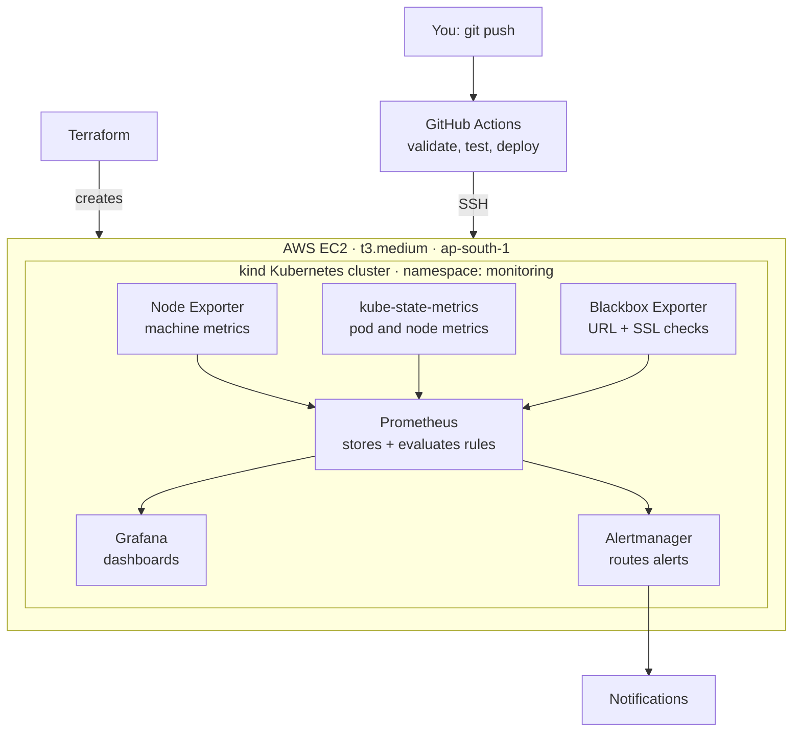
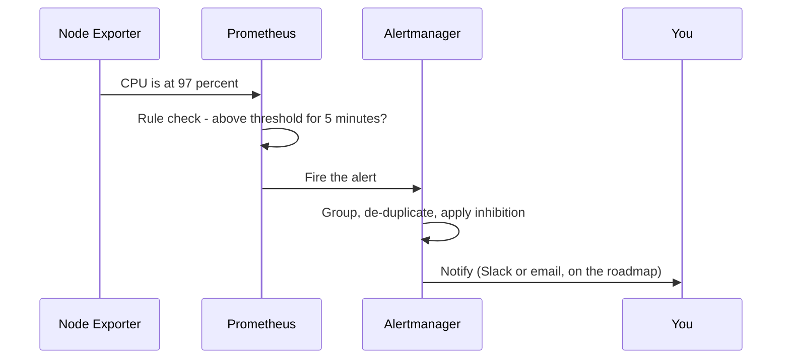
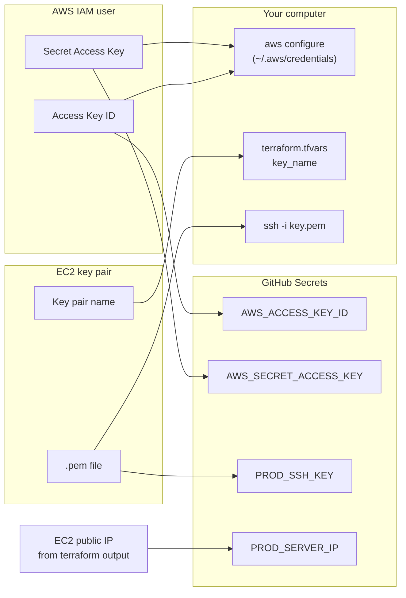
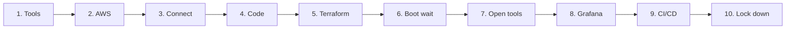
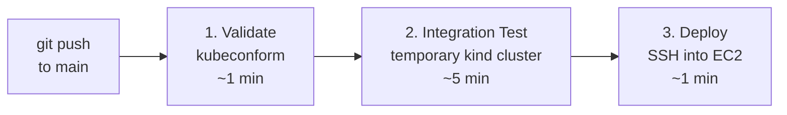

<div align="center">

# OVERWATCH

### Your Kubernetes cluster, under constant watch.

**See what is happening. Get alerted when it breaks. Know what it costs.**
One `terraform apply` builds the whole thing. Every `git push` keeps it current.

<br>

[](https://github.com/Shubhamx18/overwatch/actions/workflows/deploy.yml)


<br>


</div>

<br>

| Setup time | Runs on | Monitors | Deployed by |
|:---:|:---:|:---:|:---:|
| **~30 minutes** | **1 EC2 server**<br>t3.medium, Mumbai | **Nodes, pods, URLs, cost** | **Terraform + GitHub Actions** |

---

## Contents

1. [Why Overwatch](#1-why-overwatch)
2. [Quick Start](#2-quick-start)
3. [How It Works](#3-how-it-works)
4. [Your Credentials Kit](#4-your-credentials-kit)
5. [Full Setup Walkthrough](#5-full-setup-walkthrough)
6. [Take It for a Spin](#6-take-it-for-a-spin)
7. [Screenshot Tour](#7-screenshot-tour)
8. [FinOps: Know What It Costs](#8-finops-know-what-it-costs)
9. [CI/CD: Push and Forget](#9-cicd-push-and-forget)
10. [Daily Operations](#10-daily-operations)
11. [Troubleshooting](#11-troubleshooting)
12. [Security Checklist](#12-security-checklist)
13. [Why It Is Built This Way](#13-why-it-is-built-this-way)
14. [Project Structure](#14-project-structure)
15. [Glossary](#15-glossary)
16. [Roadmap](#16-roadmap)

---

## 1. Why Overwatch

Servers do not crash loudly. They go quiet.

> Without monitoring, you learn about an outage **from an angry user**, and you learn about wasted cloud spend **from the bill**.

Overwatch is a complete observability stack that fixes both. Three questions, three answers:

| You ask | Overwatch answers with | Where you see it |
|---|---|---|
| **"Is my cluster healthy?"** | Live metrics from every node and pod | Grafana dashboards |
| **"Will I know when something breaks?"** | Smart alert routing and de-duplication | Alertmanager |
| **"What is this costing me?"** | Utilization vs. cost, per hour, day and month | FinOps dashboard |

And nothing is clicked together by hand. It is all code:

- **Terraform** builds the server and its firewall.
- **Kubernetes manifests** define every monitoring component.
- **GitHub Actions** tests and deploys each push to `main`.

<details>
<summary><b>See the full feature list</b></summary>

<br>

- **Cluster monitoring**: nodes, pods and Kubernetes objects scraped by Prometheus
- **Auto-provisioned dashboards**: Grafana loads the main dashboards on startup
- **Smart alerting**: Alertmanager routing and inhibition rules
- **Uptime and SSL checks**: websites probed with Blackbox Exporter
- **FinOps dashboard**: CPU, RAM and disk utilization plus EC2 cost projections
- **Infrastructure as Code**: EC2, security group and default VPC detection with Terraform
- **Zero-touch boot**: the server installs Docker, kind and kubectl, then deploys the stack by itself
- **CI/CD**: manifest validation, an integration test on a throwaway kind cluster, automatic deployment

</details>

---

## 2. Quick Start

Already have an AWS access key, an EC2 key pair in `ap-south-1`, and Git, Terraform and the AWS CLI installed? Here is the whole thing:

```bash
aws configure                    # paste your keys, region: ap-south-1
git clone https://github.com/Shubhamx18/overwatch.git
cd overwatch/terraform-aws/prometheus-stack

# edit terraform.tfvars  ->  key_name = "your-key-pair-name"

terraform init
terraform apply                  # type "yes"
```

Wait about 5 minutes, then open the URL Terraform printed: `http://<ec2_public_ip>:3000`

That is it. **If any word in that block was unfamiliar, skip to the [Full Setup Walkthrough](#5-full-setup-walkthrough)**, which explains every step.

---

## 3. How It Works

### The idea in 20 seconds

Picture a hospital ward.

| In the hospital | In Overwatch | What it does |
|---|---|---|
| Sensors on every patient | **Exporters** | Measure CPU, RAM, pods, website uptime |
| The nurse writing down readings | **Prometheus** | Collects and stores every number |
| The monitor above the bed | **Grafana** | Turns numbers into dashboards |
| The alarm | **Alertmanager** | Rings when something looks wrong |

### The architecture



### The life of an alert

This is what happens in the background while you are not looking:



### From zero to running

| # | What happens | Who does it |
|:---:|---|---|
| 1 | The EC2 server and its firewall are created | **Terraform** |
| 2 | The server installs Docker, kind and kubectl | **Boot script** |
| 3 | It clones this repo and builds the Kubernetes cluster | **Boot script** |
| 4 | It deploys the full monitoring stack | **Boot script** |
| 5 | Exporters publish metrics, Prometheus collects them | Automatic |
| 6 | Grafana draws them, Alertmanager watches them | Automatic |
| 7 | Every `git push` redeploys the manifests | **GitHub Actions** |

### Meet the components

| Component | Its one job | Runs as |
|---|---|---|
| **Prometheus** | Collect and store metrics, evaluate rules | Deployment |
| **Grafana** | Draw dashboards | Deployment |
| **Alertmanager** | Route, group and send alerts | Deployment |
| **Node Exporter** | Report CPU, RAM, disk and network | DaemonSet (one per node) |
| **kube-state-metrics** | Report the state of pods and nodes | Deployment |
| **Blackbox Exporter** | Probe URLs for uptime and SSL expiry | Deployment |

> [!NOTE]
> The kind "nodes" (a control plane plus workers) are Docker containers on the **same** EC2 machine. Every Node Exporter reports on that one machine, so all nodes show near-identical memory and load. That is expected, not a bug.

---

## 4. Your Credentials Kit

Overwatch needs a handful of keys and names. This section is the one place that lists **all** of them. Skim it now, and come back whenever you wonder "where did that go?"

### 4.1 The complete list

| # | Name | What it is | Where you get it | Where it goes | Secret? |
|:---:|---|---|---|---|:---:|
| 1 | **AWS Access Key ID** | Your username for AWS | AWS Console → IAM → Users → *your user* → Security credentials → Create access key | `aws configure` **and** GitHub secret `AWS_ACCESS_KEY_ID` | Private |
| 2 | **AWS Secret Access Key** | Your password for AWS | Same screen. **Shown only once** | `aws configure` **and** GitHub secret `AWS_SECRET_ACCESS_KEY` | **Yes** |
| 3 | **AWS Region** | Where everything is built | Fixed value: `ap-south-1` | `aws configure` (default region) | No |
| 4 | **Key pair name** | The label of your SSH key, such as `overwatch-key` | AWS Console → EC2 → Key Pairs → Create key pair | `key_name` in `terraform.tfvars` | No |
| 5 | **Key pair file (`.pem`)** | Your SSH private key. **Downloaded only once** | Downloaded when you create the key pair | Your computer **and** GitHub secret `PROD_SSH_KEY` (whole file) | **Yes** |
| 6 | **EC2 public IP** | The address of your server | `terraform output ec2_public_ip` | GitHub secret `PROD_SERVER_IP` | No, but it changes after a stop/start |
| 7 | **Grafana login** | Username and password for dashboards | Defined in the Grafana manifest under `k8s/grafana/` | Used at `http://<EC2-IP>:3000`. **Change it on first login** | **Yes** |
| 8 | **GitHub environment** | A named deployment target. Has no value | GitHub → Settings → Environments → New environment | Name it exactly `production` | No |

### 4.2 The map: what goes where



> [!NOTE]
> **Nothing secret lives on the EC2 server.** The instance has no IAM role, and your AWS keys stay on your computer and in GitHub.

### 4.3 The four GitHub secrets

Only needed for [CI/CD](#9-cicd-push-and-forget). Add them at **GitHub repo → Settings → Secrets and variables → Actions → New repository secret**.

| Secret name (type it exactly) | What to paste | How to get it |
|---|---|---|
| `AWS_ACCESS_KEY_ID` | Your access key ID, like `AKIA...` | Saved when you created the access key |
| `AWS_SECRET_ACCESS_KEY` | Your secret access key | Saved when you created the access key |
| `PROD_SSH_KEY` | The **entire** `.pem` file, including the `-----BEGIN` and `-----END` lines | `cat overwatch-key.pem` (Mac/Linux) or `Get-Content .\overwatch-key.pem` (PowerShell) |
| `PROD_SERVER_IP` | The server's public IP, like `3.110.113.96` | `terraform output ec2_public_ip` |

Then create one **environment**: **Settings → Environments → New environment → `production`**.

### 4.4 Keep secrets out of Git

Put this in your `.gitignore` **before your first commit**:

```gitignore
*.pem
.env
*.tfstate
*.tfstate.*
.terraform/
```

> [!IMPORTANT]
> Never commit a `.pem` file, AWS keys, `.env`, or Terraform state. **If a key leaks:** IAM → Users → Security credentials → delete that access key → create a new one → update `aws configure` **and** both GitHub secrets.

---

## 5. Full Setup Walkthrough

Ten phases, about 30 minutes. Each one ends with a **check**. If the check fails, stop and fix it before moving on.



### What is manual and what is not

| You do (once) | Overwatch does (always) |
|---|---|
| Create an AWS account, IAM user and access key | Finds your default VPC and subnets |
| Create an EC2 key pair, save the `.pem` | Creates the EC2 server and security group |
| Install Git, Terraform and AWS CLI | Installs Docker, kind and kubectl on the server |
| Run `aws configure` | Builds the Kubernetes cluster |
| Put `key_name` in `terraform.tfvars` | Deploys Prometheus, Grafana, Alertmanager and exporters |
| Run `terraform apply` | Loads the FinOps and Node Exporter dashboards |
| Change the Grafana password | Computes cost and utilization metrics |
| Add 4 GitHub secrets (CI/CD only) | Tests and deploys every push |

---

### Phase 1: Tools &nbsp;&middot;&nbsp; 10 min

**Goal:** get Git, Terraform and the AWS CLI onto your computer.

| Tool | Get it | Check with |
|---|---|---|
| Git | https://git-scm.com/downloads | `git --version` |
| Terraform | https://developer.hashicorp.com/terraform/install | `terraform -version` |
| AWS CLI v2 | https://aws.amazon.com/cli/ | `aws --version` |

You also need an SSH client. macOS, Linux and Windows 10/11 (PowerShell) already have one.

> **Check:** all three commands print a version.

---

### Phase 2: Your AWS keys &nbsp;&middot;&nbsp; 10 min

**Goal:** collect the two things Terraform needs from AWS: an **access key** and a **key pair**.

#### 2.1 Create an IAM user and an access key

1. Open **AWS Console → IAM → Users → Create user**.
2. Attach the policy **`AmazonEC2FullAccess`** (enough for a demo).
3. Open the new user → **Security credentials → Create access key**.
4. Choose the use case **Command Line Interface (CLI)**.
5. **Copy both values now.** The secret key is shown only once.

#### 2.2 Create an EC2 key pair

1. Switch the console region (top right) to **Asia Pacific (Mumbai) `ap-south-1`**.
2. Go to **EC2 → Key Pairs → Create key pair**.
3. Name it, for example `overwatch-key`. Choose **RSA** and **.pem**.
4. Save the downloaded file somewhere safe, then lock it:

```bash
# macOS / Linux
chmod 400 overwatch-key.pem
```

```powershell
# Windows PowerShell
icacls .\overwatch-key.pem /inheritance:r /grant:r "$($env:USERNAME):R"
```

> [!WARNING]
> Key pairs belong to a **region**. A key made anywhere other than `ap-south-1` will not work here.

#### 2.3 Confirm a default VPC exists

Go to **VPC → Your VPCs**. One should say **Default VPC: Yes**. If not, choose **Actions → Create default VPC**.

> **Check:** you now hold an Access Key ID, a Secret Access Key, a `.pem` file, and a default VPC in `ap-south-1`.

---

### Phase 3: Connect to AWS &nbsp;&middot;&nbsp; 1 min

**Goal:** let your terminal act on your AWS account.

```bash
aws configure
```

| It asks | You type |
|---|---|
| AWS Access Key ID | your access key ID |
| AWS Secret Access Key | your secret access key |
| Default region name | `ap-south-1` |
| Default output format | `json` |

Your keys are saved in `~/.aws/credentials` (Windows: `C:\Users\<you>\.aws\credentials`). Now test them:

```bash
aws sts get-caller-identity
```

> **Check:** it prints your account ID and the IAM user's ARN. An error means the keys are wrong.

---

### Phase 4: Get the code &nbsp;&middot;&nbsp; 1 min

**Goal:** download Overwatch and tell it which SSH key to use.

```bash
git clone https://github.com/Shubhamx18/overwatch.git
cd overwatch
```

Open `terraform-aws/prometheus-stack/terraform.tfvars` and set your key pair **name** (no `.pem`):

```hcl
key_name = "overwatch-key"   # the name from AWS Console → EC2 → Key Pairs
```

> [!NOTE]
> **Using a fork?** The server's boot script clones the repo on its own. Change the repository URL in the user-data script inside `terraform-aws/modules/ec2/` so the server pulls **your** fork.

> **Check:** `terraform.tfvars` shows your key pair name.

---

### Phase 5: Build the server &nbsp;&middot;&nbsp; 3 min

**Goal:** let Terraform create the EC2 server and its firewall.

```bash
cd terraform-aws/prometheus-stack
terraform init       # downloads the AWS provider
terraform plan       # optional: preview what will be created
terraform apply      # type "yes" when asked
```

It creates:

- One **EC2 `t3.medium`** instance in `ap-south-1`
- One **security group** opening ports `22`, `3000`, `9090`, `9093` and `9115`

When it finishes, it prints:

```
ec2_public_ip = "X.X.X.X"
grafana_url   = "http://X.X.X.X:3000"
ssh_command   = "ssh -i <key>.pem ubuntu@X.X.X.X"
```

> [!IMPORTANT]
> **Save the IP.** You need it for every tool and for the `PROD_SERVER_IP` secret.
>
> **Keep the `terraform.tfstate` file.** It is Terraform's memory of what it built. Lose it, and Terraform can no longer manage or destroy your server.

> **Check:** the EC2 console shows the instance as **Running**.

---

### Phase 6: The server builds itself &nbsp;&middot;&nbsp; 5 min

**Goal:** wait. The boot script does everything. You can watch it work:

```bash
ssh -i overwatch-key.pem ubuntu@<EC2-IP> "tail -f /var/log/monitoring-setup.log"
```

In order, it will:

1. Install Docker, kind and kubectl
2. Clone this repository
3. Create the kind cluster
4. Deploy every monitoring component

When the log goes quiet, check the pods:

```bash
ssh -i overwatch-key.pem ubuntu@<EC2-IP> \
  "export KUBECONFIG=/home/ubuntu/.kube/config && kubectl get pods -n monitoring"
```

You should see something like this (names and ages will differ):

```
NAME                                  READY   STATUS    RESTARTS   AGE
alertmanager-xxxxxxxxxx-xxxxx         1/1     Running   0          4m
blackbox-exporter-xxxxxxxxxx-xxxxx    1/1     Running   0          4m
grafana-xxxxxxxxxx-xxxxx              1/1     Running   0          4m
kube-state-metrics-xxxxxxxxxx-xxxxx   1/1     Running   0          4m
node-exporter-xxxxx                   1/1     Running   0          4m
node-exporter-xxxxx                   1/1     Running   0          4m
node-exporter-xxxxx                   1/1     Running   0          4m
prometheus-xxxxxxxxxx-xxxxx           1/1     Running   0          4m
```

> **Check:** **8 pods, all `Running`**: five single pods plus one node-exporter on each of the 3 nodes.

---

### Phase 7: Open the tools &nbsp;&middot;&nbsp; 1 min

**Goal:** see it live. Use `http://`, **not** `https://`.

| Tool | URL | Look for |
|---|---|---|
| **Grafana** | `http://<EC2-IP>:3000` | Your dashboards |
| **Prometheus** | `http://<EC2-IP>:9090` | `/targets` with everything **UP** |
| **Alertmanager** | `http://<EC2-IP>:9093` | Status **ready** |
| **Blackbox Exporter** | `http://<EC2-IP>:9115` | Probe results |

---

### Phase 8: Log in to Grafana &nbsp;&middot;&nbsp; 3 min

**Goal:** get in, lock it down, find your dashboards.

1. Open `http://<EC2-IP>:3000`.
2. Log in with the credentials defined in the Grafana manifest under `k8s/grafana/`.
3. **Change the password immediately:** profile icon → **Profile → Change password**.
4. Open **Dashboards**. Two are already waiting for you:
   - **FinOps: Cost Intelligence**
   - **Node Exporter**

<details>
<summary><b>Optional: import more community dashboards</b></summary>

<br>

Go to **Dashboards → New → Import**, type the ID, click **Load**, pick the **Prometheus** data source, click **Import**.

| ID | Dashboard |
|---|---|
| `1860` | Node Exporter Full |
| `7249` | Kubernetes Cluster |
| `13332` | kube-state-metrics |

</details>

> [!TIP]
> A dashboard says **"No data"**? Look at the dropdowns at the top (Job, Instance, Nodename, cluster) and pick a value. The Node Exporter screenshots use **Job: `kubernetes-pods`**. A `cluster: None` dropdown on the Kubernetes dashboard is normal for a single cluster.

> **Check:** the FinOps dashboard shows live numbers.

---

### Phase 9: Auto-deploy with CI/CD &nbsp;&middot;&nbsp; 5 min

**Goal:** make every `git push` redeploy by itself. **Optional.** Skip it if you only want to run the stack once.

1. **Use your own GitHub repo.** Fork this one, or push your copy to a new repo.
2. **Add the four secrets** from [section 4.3](#43-the-four-github-secrets): `AWS_ACCESS_KEY_ID`, `AWS_SECRET_ACCESS_KEY`, `PROD_SSH_KEY`, `PROD_SERVER_IP`.
3. **Create the environment** named `production` (Settings → Environments).
4. **Push a change:**

```bash
git add .
git commit -m "first pipeline run"
git push origin main
```

> **Check:** the **Actions** tab shows three green stages: Validate, Integration Test, Deploy.

---

### Phase 10: Lock it down &nbsp;&middot;&nbsp; 5 min

Before you walk away, work through the [Security Checklist](#12-security-checklist). Read the SSH warning there first, because it affects the pipeline.

---

## 6. Take It for a Spin

Do not just trust that it works. Prove it.

### The health checklist

| Check | How | You should see |
|---|---|---|
| Server is up | EC2 Console | State **Running** |
| Pods are healthy | `kubectl get pods -n monitoring` | 8 pods `Running` |
| Metrics are flowing | Prometheus → **Status → Targets** | Every target **UP** |
| Dashboards are alive | Grafana → Dashboards | FinOps and Node Exporter show data |
| Alerting is ready | Alertmanager → **Status** | Cluster status **ready** |
| Pipeline works | GitHub → Actions | Three green stages |

### Experiment 1: Send a fake alert

Push an alert straight into Alertmanager:

```bash
curl -XPOST http://<EC2-IP>:9093/api/v2/alerts \
  -H 'Content-Type: application/json' \
  -d '[{"labels":{"alertname":"TestAlert","severity":"warning"}}]'
```

Refresh the Alertmanager page. **`TestAlert` appears.**

> [!NOTE]
> Until you add a receiver (Slack or email, see the [Roadmap](#16-roadmap)), alerts show up in the UI but are not sent anywhere else.

### Experiment 2: Break something on purpose

Switch off kube-state-metrics, then watch Prometheus notice:

```bash
# 1. Break it
ssh -i <key>.pem ubuntu@<EC2-IP> \
  "export KUBECONFIG=/home/ubuntu/.kube/config && \
   kubectl scale deployment kube-state-metrics --replicas=0 -n monitoring"

# 2. Open http://<EC2-IP>:9090/targets and refresh.
#    Its target should turn DOWN within a minute or so.

# 3. Fix it
ssh -i <key>.pem ubuntu@<EC2-IP> \
  "export KUBECONFIG=/home/ubuntu/.kube/config && \
   kubectl scale deployment kube-state-metrics --replicas=1 -n monitoring"
```

That is monitoring doing its job: something died, and you saw it.

---

## 7. Screenshot Tour

A walk through the running stack, following the data from the machine up to the workloads.

### Step 1: The server (AWS EC2)

Terraform creates a `t3.medium` instance in `ap-south-1`, in the default VPC. Everything below runs on this one machine.


### Step 2: Alerting (Alertmanager)

Alertmanager reports `ready`. Prometheus sends alerts here, so you hear about trouble before your users do.


### Step 3: The whole cluster (Grafana)

How much of the cluster's pod, CPU and memory capacity is already requested by workloads. This is where right-sizing starts.


### Step 4: One node up close (Node Exporter)

A single node at a glance: CPU busy, system load, RAM and swap used, pressure, core count, total RAM and uptime.


### Step 5: Resource utilization (FinOps dashboard)

Load, memory, disk I/O and the most memory-hungry pods over time. Low usage next to a steady cost is the signature of an over-provisioned resource.


### Step 6: The workloads (pod and node health)

Running pods, restarts, CPU idle and node storage, all in one glance.


> [!TIP]
> Every view above reads the same Prometheus data. Only the zoom level changes.

---

## 8. FinOps: Know What It Costs

Most monitoring tells you what is running. Overwatch also tells you **what that costs**.

Prometheus **recording rules** pre-compute the numbers every 15 seconds, so dashboards open instantly instead of crunching data on every refresh.

### The rule of thumb

> **Low utilization + steady cost = over-provisioned.**
> That gap is where the savings are.

### What gets measured

**Utilization**

| Metric | Meaning |
|---|---|
| `finops:cpu_utilization_24h` | Current CPU usage % |
| `finops:ram_utilization_24h` | Current RAM usage % |
| `finops:disk_utilization` | Current disk usage % |
| `finops:total_ram_gb` | Total RAM in GB |

**Cost**

| Metric | Meaning |
|---|---|
| `finops:ec2_hourly_cost_usd` | EC2 cost per hour (t3.medium, ap-south-1) |
| `finops:ec2_session_cost_usd` | Cost since the instance booted |
| `finops:ec2_daily_cost_usd` | Projected daily cost |
| `finops:ec2_monthly_cost_usd` | Projected monthly cost |

> [!NOTE]
> The cost metrics use a fixed hourly price for `t3.medium` in `ap-south-1`. If you change the instance type or region, update the price in the recording rules under `k8s/prometheus/`.

---

## 9. CI/CD: Push and Forget

Edit a manifest, push to `main`, and walk away. A three-stage pipeline (`.github/workflows/deploy.yml`) does the rest:



| Stage | What it does |
|---|---|
| **1. Validate** | Checks every Kubernetes manifest with `kubeconform` |
| **2. Integration Test** | Starts a throwaway kind cluster, deploys everything, checks that Prometheus and Grafana are healthy |
| **3. Deploy** | SSHes into EC2, runs `git pull` and `kubectl apply --server-side` |

**The safety net:** if any stage fails, the pipeline stops, so a broken manifest never reaches your server.

**Secrets it uses:** `AWS_ACCESS_KEY_ID`, `AWS_SECRET_ACCESS_KEY`, `PROD_SSH_KEY`, `PROD_SERVER_IP`, plus the `production` environment. See [section 4.3](#43-the-four-github-secrets).

### After a Prometheus config change

`kubectl apply` updates the ConfigMap, but Prometheus only reads its config **at startup**. Restart it to load new alert rules, recording rules and scrape configs:

```bash
ssh -i <key>.pem ubuntu@<EC2-IP> \
  "export KUBECONFIG=/home/ubuntu/.kube/config && \
   kubectl rollout restart deployment prometheus grafana -n monitoring"
```

---

## 10. Daily Operations

### Cheat sheet

| I want to... | Run this |
|---|---|
| SSH into the server | `ssh -i <key>.pem ubuntu@<EC2-IP>` |
| Check the pods | `kubectl get pods -n monitoring` |
| See scrape targets | open `http://<EC2-IP>:9090/targets` |
| Watch the boot log | `tail -f /var/log/monitoring-setup.log` |
| Deploy a change | `git push origin main` |
| Get the server IP | `terraform output ec2_public_ip` |
| Build or destroy everything | `terraform apply` / `terraform destroy` |

### The IP changed after a stop/start

A normal public IP changes every time the instance is stopped and started.

```bash
cd terraform-aws/prometheus-stack
terraform output ec2_public_ip      # get the new IP
# then update the PROD_SERVER_IP GitHub secret
```

For a permanent address, allocate an **Elastic IP** (AWS Console → EC2 → Elastic IPs) and attach it to the instance. AWS charges for public IPv4 addresses.

### Restart a component

```bash
ssh -i <key>.pem ubuntu@<EC2-IP> \
  "export KUBECONFIG=/home/ubuntu/.kube/config && \
   kubectl rollout restart deployment prometheus -n monitoring"
```

### Stop paying, then bring it back

```bash
cd terraform-aws/prometheus-stack
terraform destroy      # delete everything (type "yes")
terraform apply        # recreate it, then wait ~5 minutes
```

> [!WARNING]
> A running EC2 instance is billed by the hour. After `terraform destroy`, confirm in the EC2 console that nothing is still running.

---

## 11. Troubleshooting

Find your symptom, apply the fix.

<details>
<summary><b>While setting up</b></summary>

<br>

| Symptom | Likely cause and fix |
|---|---|
| `aws sts get-caller-identity` fails | Wrong or missing keys. Run `aws configure` again |
| `terraform apply`: `InvalidKeyPair.NotFound` | `key_name` is misspelled, includes `.pem`, or the key was made in a region other than `ap-south-1` |
| `terraform apply`: `UnauthorizedOperation` | The IAM user lacks EC2 permissions. Attach `AmazonEC2FullAccess` |
| Terraform cannot find a VPC or subnet | No default VPC. VPC console → Actions → Create default VPC |
| `ssh`: `Permission denied (publickey)` | Wrong key, wrong user (it is `ubuntu`), or loose file permissions (`chmod 400`) |
| `ssh` times out | Instance still starting, IP changed, or port 22 blocked in the security group |

</details>

<details>
<summary><b>After setup: the stack is running but something is off</b></summary>

<br>

| Symptom | Likely cause and fix |
|---|---|
| `ERR_CONNECTION_TIMED_OUT` in the browser | IP changed after a stop/start, a security group rule is missing, you used `https://`, or the boot script is still running |
| Pods not ready | Check `tail -f /var/log/monitoring-setup.log`. Pods stuck `Pending` can mean the t3.medium is out of memory |
| Prometheus targets show 403 | Make sure `k8s/prometheus/kubelet-rbac.yaml` is applied |
| Grafana panel says "No data" | Check the dropdowns (Job, Instance, Nodename) and confirm the target is **UP** in Prometheus |
| Dashboard not updating after a config change | Restart Prometheus and Grafana ([how](#after-a-prometheus-config-change)) |

</details>

<details>
<summary><b>CI/CD pipeline problems</b></summary>

<br>

| Symptom | Likely cause and fix |
|---|---|
| `Permission denied (publickey)` | `PROD_SSH_KEY` is incomplete. Paste the whole file, including the `BEGIN` and `END` lines |
| Deploy cannot connect | `PROD_SERVER_IP` is outdated, or port 22 no longer allows GitHub's runners ([why](#12-security-checklist)) |

</details>

---

## 12. Security Checklist

### What is open to the world

| Port | Service | Has a login? |
|---|---|:---:|
| 22 | SSH | Key only |
| 3000 | Grafana | Yes |
| 9090 | Prometheus | **No** |
| 9093 | Alertmanager | **No** |
| 9115 | Blackbox Exporter | **No** |

By default, every one of these accepts traffic from anywhere (`0.0.0.0/0`). That is fine for a demo and risky for anything else.

### Before you walk away

- [ ] **Change the Grafana password** after the first login
- [ ] **Restrict ports 9090, 9093 and 9115** to your own IP (find it with `curl ifconfig.io`). They have no login
- [ ] **Never commit** your `.pem`, AWS keys, `.env` or Terraform state ([section 4.4](#44-keep-secrets-out-of-git))
- [ ] Use a **dedicated IAM user** with limited permissions, and **rotate its keys** regularly

> [!WARNING]
> **Do not lock SSH (port 22) to your IP if you use the pipeline.** The Deploy stage connects from GitHub-hosted runners, and their IPs change constantly, so the stage would fail. Pick one: keep port 22 open with key-only login, use a self-hosted runner, or deploy through AWS Systems Manager.

---

## 13. Why It Is Built This Way

Every odd-looking choice in this repo has a reason.

**Dashboards load themselves.** The dashboard JSON lives in a ConfigMap, gets mounted into the Grafana pod, and a provider ConfigMap tells Grafana to load it on startup. No manual import for the main dashboards.

**`kubectl apply --server-side`, everywhere.** The Node Exporter dashboard JSON is about 300 KB. A normal `kubectl apply` stores the full config in an annotation, which has a 262 KB limit, so it fails. Server-side apply has no such limit.

**No hardcoded VPC IDs.** Terraform finds your default VPC and subnets with data sources, so the same code works in any account.

**A kubelet RBAC patch.** `k8s/prometheus/kubelet-rbac.yaml` gives Prometheus permission to read kubelet metrics. Without it, the `kubernetes-nodes` and `kubernetes-cadvisor` targets return 403.

**Two port layouts.** Local kind (`kind-cluster.yaml`) uses Grafana `13000` and Prometheus `19090` to avoid clashing with other tools. EC2 (`kind-cluster-ec2.yaml`) uses the standard `3000` and `9090`.

**Pre-computed FinOps numbers.** Recording rules calculate cost and utilization every 15 seconds, so a dashboard reads a ready answer instead of running a heavy query on every refresh.

### Tech stack

| Area | Tools |
|---|---|
| **Monitoring** | Prometheus, Node Exporter, kube-state-metrics, Blackbox Exporter |
| **Visualization** | Grafana |
| **Alerting** | Alertmanager |
| **Orchestration** | Kubernetes (kind), kubectl |
| **Infrastructure** | Terraform, AWS EC2, Security Groups |
| **CI/CD** | GitHub Actions, kubeconform |

---

## 14. Project Structure

```
overwatch/
├── .github/workflows/
│   └── deploy.yml              # CI/CD pipeline
├── assets/                     # Screenshots used in this README
├── k8s/
│   ├── kind/                   # kind cluster configs (local and EC2)
│   ├── namespace/              # monitoring namespace
│   ├── prometheus/             # Prometheus, alert rules, FinOps recording rules, kubelet RBAC
│   ├── alertmanager/           # Alertmanager config and routing
│   ├── grafana/                # Grafana + auto-provisioned dashboards
│   ├── node-exporter/          # DaemonSet on every node
│   ├── kube-state-metrics/     # Kubernetes object metrics + RBAC
│   └── blackbox-exporter/      # URL and SSL probing
├── terraform-aws/
│   ├── modules/
│   │   ├── ec2/                # EC2 instance + user-data boot script
│   │   └── security-group/     # Firewall rules
│   └── prometheus-stack/       # Main Terraform config and variables
├── Makefile
├── .env.example
└── README.md
```

---

## 15. Glossary

<details>
<summary><b>New to this? Open the plain-English dictionary</b></summary>

<br>

| Term | Plain-English meaning |
|---|---|
| **Observability** | Being able to see what is happening inside your systems |
| **Metric** | A number measured over time, such as CPU usage |
| **Exporter** | A small program that exposes metrics for Prometheus to collect |
| **Scrape** | Prometheus visiting an exporter to read its current numbers |
| **Recording rule** | A saved calculation that Prometheus runs ahead of time |
| **Alert rule** | A condition, like "CPU above 90% for 5 minutes", that triggers an alert |
| **Inhibition** | Muting a small alert when a bigger one already explains it |
| **kind** | "Kubernetes in Docker": a cluster that runs inside containers |
| **Manifest** | A YAML file describing something to run in Kubernetes |
| **ConfigMap** | A Kubernetes object that holds configuration files |
| **DaemonSet** | A workload that runs one pod on every node |
| **Terraform** | A tool that creates cloud resources from code |
| **user-data** | A script AWS runs automatically the first time an instance boots |
| **IAM user** | A named identity in AWS with its own keys and permissions |
| **Key pair** | A public/private SSH key pair. AWS keeps the public half; you keep the `.pem` |
| **FinOps** | Managing cloud cost by comparing usage with spend |

</details>

---

## 16. Roadmap

- [ ] Elastic IP managed by Terraform
- [ ] Switch AWS credentials to GitHub OIDC (no stored keys)
- [ ] Slack or email alert notifications
- [ ] Per-container metrics with cAdvisor
- [ ] Remote Terraform state in S3

---

<div align="center">

**Built by [Shubham](https://github.com/Shubhamx18)**

If Overwatch helped you, consider giving it a star on GitHub.

</div>
