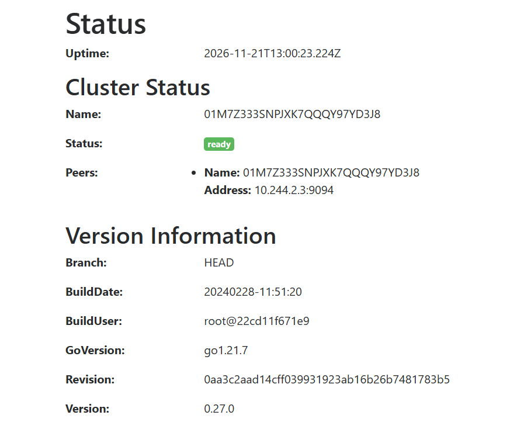

<div align="center">

# 🔭 Overwatch

### Kubernetes Monitoring, Alerting & FinOps Platform on AWS

Monitor a Kubernetes cluster, get alerted when something breaks, and see what your cloud setup costs, all deployed automatically with Terraform and GitHub Actions.

[](https://github.com/Shubhamx18/overwatch/actions/workflows/deploy.yml)


<br><br>


</div>

---

## 📌 What is Overwatch?

Overwatch is a production-style **observability stack** that runs on Kubernetes (kind) on an AWS EC2 server. It answers three questions:

| Question | Answered by |
|---|---|
| **Is my cluster healthy?** | Prometheus + Grafana dashboards |
| **Will I know when something breaks?** | Alertmanager with smart routing |
| **What is this costing me?** | FinOps dashboard with cost and utilization metrics |

Everything is code: infrastructure is created by **Terraform**, the stack is deployed with **Kubernetes manifests**, and every push to `main` goes through a **CI/CD pipeline**.

---

## ✨ Features

- **Cluster monitoring** with Prometheus scraping nodes, pods and Kubernetes objects
- **Dashboards** in Grafana, auto-provisioned on startup (no manual setup for the main ones)
- **Smart alerting** with Alertmanager routing and inhibition rules
- **Uptime and SSL checks** for websites using Blackbox Exporter
- **FinOps dashboard** showing CPU, RAM and disk utilization with EC2 cost projections (hourly, daily, monthly)
- **Infrastructure as Code** with Terraform (EC2, security group, default VPC auto-detection)
- **Automated boot**: EC2 installs Docker, kind and kubectl, then deploys the whole stack by itself
- **CI/CD pipeline** with validation, integration testing and automatic deployment

---

## 📸 Screenshots

### FinOps: Cost Intelligence dashboard

| Resource utilization and trends | Capacity forecasting (next 14 days) |
|---|---|
|  |  |


### Kubernetes cluster overview (Grafana)


### Alertmanager



### Running on AWS


---

## 🏗️ Architecture

```
                         ┌────────────────────────┐
   git push ───────────► │     GitHub Actions     │
                         │ validate → test → deploy│
                         └───────────┬────────────┘
                                     │ SSH
                                     ▼
┌──────────────────────── AWS EC2 (t3.medium, ap-south-1) ──────────────────────┐
│                                                                               │
│   ┌───────────────────── kind Kubernetes cluster ─────────────────────────┐   │
│   │                      namespace: monitoring                            │   │
│   │                                                                       │   │
│   │  Node Exporter ──┐                                                    │   │
│   │  kube-state-metrics ──┼──►  Prometheus  ──►  Grafana (dashboards)     │   │
│   │  Blackbox Exporter ──┘         │                                      │   │
│   │                                ▼                                      │   │
│   │                          Alertmanager  ──►  notifications             │   │
│   └───────────────────────────────────────────────────────────────────────┘   │
└───────────────────────────────────────────────────────────────────────────────┘
        ▲
        │ created by
   Terraform (EC2 + Security Group)
```

### Components

| Component | Role |
|---|---|
| **Prometheus** | Collects and stores metrics, evaluates alert and recording rules |
| **Grafana** | Dashboards (FinOps, Node Exporter, Kubernetes) |
| **Alertmanager** | Routes, groups and sends alerts |
| **Node Exporter** | Machine metrics (CPU, RAM, disk, network), runs on every node |
| **kube-state-metrics** | Kubernetes object metrics (pods, deployments, nodes) |
| **Blackbox Exporter** | Probes URLs for uptime and SSL expiry |

---

## 📁 Project Structure

```
overwatch/
├── .github/workflows/
│   └── deploy.yml              # CI/CD pipeline
├── k8s/
│   ├── kind/                   # kind cluster configs (local and EC2)
│   ├── namespace/              # monitoring namespace
│   ├── prometheus/             # Prometheus, alert rules, FinOps recording rules, kubelet RBAC
│   ├── alertmanager/           # Alertmanager config and routing
│   ├── grafana/                # Grafana + auto-provisioned dashboards
│   ├── node-exporter/          # DaemonSet on every node
│   ├── kube-state-metrics/     # Kubernetes object metrics + RBAC
│   └── blackbox-exporter/      # URL and SSL probing
├── terraform-aws/
│   ├── modules/
│   │   ├── ec2/                # EC2 instance + user-data boot script
│   │   └── security-group/     # Firewall rules
│   └── prometheus-stack/       # Main Terraform config and variables
├── Makefile
├── .env.example
└── README.md
```

---

## 🚀 Getting Started

### Prerequisites

- An **AWS account** with an access key, and an EC2 **key pair**
- [Terraform](https://developer.hashicorp.com/terraform/install)
- [AWS CLI](https://aws.amazon.com/cli/)
- Git

### 1. Clone the repo

```bash
git clone https://github.com/Shubhamx18/overwatch.git
cd overwatch
```

### 2. Configure AWS

```bash
aws configure
```

| Prompt | Value |
|---|---|
| Access Key ID | your AWS access key |
| Secret Access Key | your AWS secret key |
| Region | `ap-south-1` |
| Output format | `json` |

### 3. Set your key pair name

Open `terraform-aws/prometheus-stack/terraform.tfvars`:

```hcl
key_name = "your-key-pair-name"   # AWS Console → EC2 → Key Pairs
```

### 4. Create the server with Terraform

```bash
cd terraform-aws/prometheus-stack
terraform init
terraform apply
```

Type `yes`. Terraform prints the server details:

```
ec2_public_ip = "X.X.X.X"
grafana_url   = "http://X.X.X.X:3000"
ssh_command   = "ssh -i <key>.pem ubuntu@X.X.X.X"
```

> **Save the IP.** The VPC and subnets are detected automatically from your default VPC, so no IDs need to be pasted.

### 5. Wait for the first boot (~5 minutes)

On first boot the EC2 instance automatically:

1. Installs Docker, kind and kubectl
2. Clones this repository
3. Creates the kind cluster
4. Deploys all monitoring components

Check progress:

```bash
ssh -i <key>.pem ubuntu@<EC2-IP> "kubectl get pods -n monitoring"
ssh -i <key>.pem ubuntu@<EC2-IP> "tail -f /var/log/monitoring-setup.log"
```

You should see **8 pods Running**: alertmanager, blackbox-exporter, grafana, kube-state-metrics, prometheus, and node-exporter on each of the 3 nodes.

---

## 🌐 Access the Tools

| Tool | URL | Notes |
|---|---|---|
| **Grafana** | `http://<EC2-IP>:3000` | Login with the credentials set in the Grafana manifest |
| **Prometheus** | `http://<EC2-IP>:9090` | Check `/targets` to confirm everything is **UP** |
| **Alertmanager** | `http://<EC2-IP>:9093` | Active and silenced alerts |
| **Blackbox Exporter** | `http://<EC2-IP>:9115` | Probe results |

> Use `http://`, not `https://`. Change the default Grafana password after your first login.

### Dashboards

- **FinOps: Cost Intelligence**: loads automatically
- **Node Exporter**: loads automatically

Import these community dashboards in Grafana (**Dashboards → New → Import**) and select the Prometheus data source:

| ID | Dashboard |
|---|---|
| `1860` | Node Exporter Full |
| `7249` | Kubernetes Cluster |
| `13332` | kube-state-metrics |

---

## 💰 FinOps Dashboard

Overwatch turns monitoring data into cost visibility. Prometheus **recording rules** pre-compute these metrics every 15 seconds so the dashboard loads instantly:

| Metric | Meaning |
|---|---|
| `finops:cpu_utilization_24h` | Current CPU usage % |
| `finops:ram_utilization_24h` | Current RAM usage % |
| `finops:disk_utilization` | Current disk usage % |
| `finops:total_ram_gb` | Total RAM in GB |
| `finops:ec2_hourly_cost_usd` | EC2 cost per hour (t3.medium, ap-south-1) |
| `finops:ec2_session_cost_usd` | Cost since the instance booted |
| `finops:ec2_daily_cost_usd` | Projected daily cost |
| `finops:ec2_monthly_cost_usd` | Projected monthly cost |

Low utilization next to a steady cost is a signal that a resource is over-provisioned and can be right-sized.

---

## 🔄 CI/CD Pipeline

Every push to `main` runs three stages (`.github/workflows/deploy.yml`):

| Stage | What it does |
|---|---|
| **1. Validate** | Checks all Kubernetes manifests with `kubeconform` (about 1 min) |
| **2. Integration Test** | Spins up a kind cluster, deploys all components, verifies Prometheus and Grafana are healthy (about 5 min) |
| **3. Deploy** | SSHes into EC2, runs `git pull` and `kubectl apply --server-side` (about 1 min) |

### Set up the pipeline

**Add repository secrets** at *Settings → Secrets and variables → Actions*:

| Secret | Value |
|---|---|
| `PROD_SERVER_IP` | Public IP of your EC2 |
| `PROD_SSH_KEY` | Full contents of your `.pem` file, including the `BEGIN` and `END` lines |
| `AWS_ACCESS_KEY_ID` | Your AWS access key |
| `AWS_SECRET_ACCESS_KEY` | Your AWS secret key |

**Create an environment** at *Settings → Environments → New environment* named `production`.

Then push:

```bash
git add .
git commit -m "your change"
git push origin main
```

### After a Prometheus config change

`kubectl apply` updates the ConfigMap, but Prometheus only reads its config at startup. Restart it to pick up new alert rules, recording rules and scrape configs:

```bash
ssh -i <key>.pem ubuntu@<EC2-IP> \
  "export KUBECONFIG=/home/ubuntu/.kube/config && \
   kubectl rollout restart deployment prometheus grafana -n monitoring"
```

---

## 🧠 Design Decisions

**Grafana dashboards are auto-provisioned.** The dashboard JSON lives in a ConfigMap, gets mounted into the Grafana pod, and a provider ConfigMap tells Grafana to load it on startup. No manual import is needed for the main dashboards.

**`kubectl apply --server-side` everywhere.** The Node Exporter dashboard JSON is about 300 KB. A normal `kubectl apply` stores the full config in an annotation, which has a 262 KB limit and fails. Server-side apply has no such limit.

**Default VPC auto-detection.** Terraform looks up your default VPC and subnets with data sources, so there are no hardcoded IDs.

**Prometheus kubelet RBAC fix.** `k8s/prometheus/kubelet-rbac.yaml` grants Prometheus access to kubelet metrics. Without it, the `kubernetes-nodes` and `kubernetes-cadvisor` targets return 403.

**Different ports locally and on EC2.** The local kind config (`kind-cluster.yaml`) uses Grafana `13000` and Prometheus `19090` to avoid port conflicts. The EC2 config (`kind-cluster-ec2.yaml`) uses the standard `3000` and `9090`.

---

## 🔒 Security Group Ports

| Port | Service |
|---|---|
| 22 | SSH |
| 3000 | Grafana |
| 9090 | Prometheus |
| 9093 | Alertmanager |
| 9115 | Blackbox Exporter |

> The rules default to `0.0.0.0/0` for easy testing. For anything beyond a demo, restrict at least SSH to your own IP (`curl ifconfig.io`).

---

## 🛠️ Daily Operations

**EC2 IP changed after a stop/start?** A normal public IP changes whenever the instance is stopped and started.

```bash
terraform output ec2_public_ip      # get the new IP
# then update the PROD_SERVER_IP GitHub secret
```

For a permanent IP, allocate an **Elastic IP** (AWS Console → EC2 → Elastic IPs) and associate it with the instance. Note that AWS charges for public IPv4 addresses.

**Restart a component**

```bash
ssh -i <key>.pem ubuntu@<EC2-IP> \
  "export KUBECONFIG=/home/ubuntu/.kube/config && \
   kubectl rollout restart deployment prometheus -n monitoring"
```

**Stop paying: destroy everything**

```bash
cd terraform-aws/prometheus-stack
terraform destroy
```

**Bring it back**

```bash
terraform apply     # then wait about 5 minutes for the boot script
```

---

## ⚡ Quick Reference

| What | Command / URL |
|---|---|
| SSH into EC2 | `ssh -i <key>.pem ubuntu@<EC2-IP>` |
| Check pods | `kubectl get pods -n monitoring` |
| Prometheus targets | `http://<EC2-IP>:9090/targets` |
| Boot log | `tail -f /var/log/monitoring-setup.log` |
| Create / destroy EC2 | `terraform apply` / `terraform destroy` |
| Deploy changes | `git push origin main` |
| Get EC2 IP | `terraform output ec2_public_ip` |

---

## 🩺 Troubleshooting

| Problem | Likely cause and fix |
|---|---|
| Browser shows `ERR_CONNECTION_TIMED_OUT` | The instance IP changed after a stop/start, an inbound rule is missing in the security group, or the boot script is still running |
| Pods not ready | Check `tail -f /var/log/monitoring-setup.log` on the server |
| Prometheus targets show 403 | Make sure `kubelet-rbac.yaml` is applied |
| Dashboard not updating after a config change | Restart Prometheus and Grafana (see above) |
| Pipeline deploy step fails to connect | `PROD_SERVER_IP` secret is outdated; update it with the current IP |

---

## 🗺️ Roadmap

- [ ] Elastic IP managed by Terraform
- [ ] Switch AWS credentials to GitHub OIDC (no stored keys)
- [ ] Slack or email alert notifications
- [ ] Per-container metrics with cAdvisor
- [ ] Remote Terraform state in S3

---

## 👤 Author

**Shubham**
GitHub: [@Shubhamx18](https://github.com/Shubhamx18)

---

<div align="center">

If this project helped you, consider giving it a ⭐

</div>
