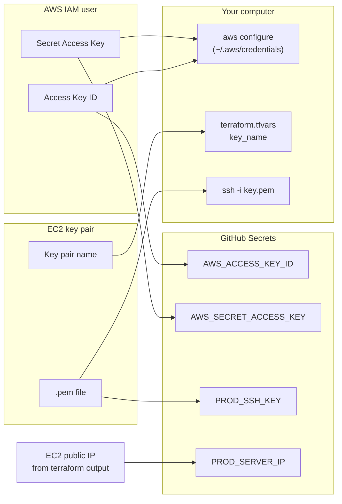
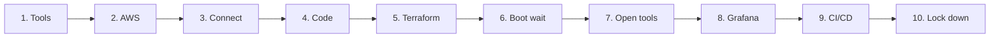
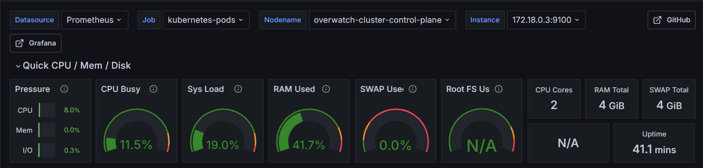
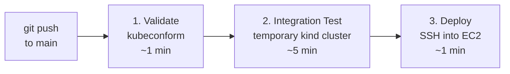

<div align="center">

# Overwatch

### Kubernetes Monitoring, Alerting & FinOps Platform on AWS

**Watch your cluster. Get alerted when it breaks. See what it costs.**
Deployed automatically with Terraform and GitHub Actions.

[](https://github.com/Shubhamx18/overwatch/actions/workflows/deploy.yml)


<br>


</div>

---

## At a Glance

| | |
|---|---|
| **What you get** | Grafana dashboards, Prometheus metrics, Alertmanager alerts, FinOps cost view |
| **Where it runs** | One AWS EC2 server (`t3.medium`, Mumbai `ap-south-1`) |
| **Setup time** | About 30 minutes (5 of them are the server setting itself up) |
| **You need** | An AWS account, a GitHub account, and a computer with a terminal |
| **Cost** | AWS bills the EC2 server by the hour. Run `terraform destroy` when you are done |

---

## Table of Contents

1. [What Is Overwatch?](#1-what-is-overwatch)
2. [How It Works](#2-how-it-works)
3. [Credentials and Secrets Cheat Sheet](#3-credentials-and-secrets-cheat-sheet)
4. [What You Do vs What Is Automated](#4-what-you-do-vs-what-is-automated)
5. [Step-by-Step Setup](#5-step-by-step-setup)
6. [Verify Everything Works](#6-verify-everything-works)
7. [Project Tour (Screenshots)](#7-project-tour-screenshots)
8. [FinOps: Cost Intelligence](#8-finops-cost-intelligence)
9. [CI/CD Pipeline](#9-cicd-pipeline)
10. [Daily Operations](#10-daily-operations)
11. [Troubleshooting](#11-troubleshooting)
12. [Security Checklist](#12-security-checklist)
13. [Design Decisions](#13-design-decisions)
14. [Tech Stack and Project Structure](#14-tech-stack-and-project-structure)
15. [Glossary](#15-glossary)
16. [Roadmap](#16-roadmap)

---

## 1. What Is Overwatch?

### The problem

Servers fail quietly. Without monitoring:

- You find out about a crash **from your users**.
- You find out about wasted cloud spend **from the bill**.

### The solution

Overwatch is a ready-made **observability stack**. It runs on a small Kubernetes cluster ([kind](https://kind.sigs.k8s.io/)) on one AWS server, and answers three questions:

| Question | Answered by | You see it in |
|---|---|---|
| **Is my cluster healthy?** | Prometheus metrics | Grafana dashboards |
| **Will I know when something breaks?** | Alertmanager | Alertmanager UI (Slack/email is on the roadmap) |
| **What is this costing me?** | FinOps recording rules | FinOps dashboard |

### Everything is code

| Tool | What it builds |
|---|---|
| **Terraform** | The EC2 server and its firewall |
| **Kubernetes manifests** | The whole monitoring stack |
| **GitHub Actions** | Tests and deploys every push to `main` |

<details>
<summary><b>Full feature list</b></summary>

- **Cluster monitoring**: nodes, pods and Kubernetes objects scraped by Prometheus
- **Auto-provisioned dashboards**: Grafana loads the main dashboards on startup
- **Smart alerting**: Alertmanager routing and inhibition rules
- **Uptime and SSL checks**: websites probed with Blackbox Exporter
- **FinOps dashboard**: CPU, RAM and disk utilization plus EC2 cost projections
- **Infrastructure as Code**: EC2, security group and default VPC detection with Terraform
- **Zero-touch boot**: the server installs Docker, kind and kubectl, then deploys the stack by itself
- **CI/CD**: manifest validation, an integration test on a throwaway kind cluster, automatic deployment

</details>

---

## 2. How It Works

### The idea in one analogy

Think of a hospital ward:

| In the hospital | In Overwatch | Job |
|---|---|---|
| Sensors on each patient | **Exporters** | Measure things (CPU, RAM, pods, website uptime) |
| The nurse who records readings | **Prometheus** | Collects and stores the numbers |
| The monitor screen | **Grafana** | Draws the numbers as dashboards |
| The alarm | **Alertmanager** | Rings when numbers look bad |

### The architecture


### What happens, step by step

| Step | What happens | Who does it |
|:---:|---|---|
| **1** | The EC2 server and its firewall are created | Terraform |
| **2** | The server installs Docker, kind and kubectl on first boot | Boot script (user-data) |
| **3** | The server clones this repo and creates the Kubernetes cluster | Boot script |
| **4** | The monitoring stack is deployed into the `monitoring` namespace | Boot script |
| **5** | Exporters expose metrics; Prometheus scrapes them on a schedule | Automatic |
| **6** | Grafana draws dashboards from Prometheus | Automatic |
| **7** | Alert rules fire; Alertmanager groups and routes the alert | Automatic |
| **8** | Every `git push` to `main` redeploys the manifests | GitHub Actions |

### The components

| Component | Role | Runs as |
|---|---|---|
| **Prometheus** | Collects and stores metrics, evaluates alert and recording rules | Deployment |
| **Grafana** | Dashboards for FinOps, nodes and the cluster | Deployment |
| **Alertmanager** | Routes, groups and sends alerts | Deployment |
| **Node Exporter** | CPU, RAM, disk and network of each node | DaemonSet (one per node) |
| **kube-state-metrics** | Status of pods, deployments and nodes | Deployment |
| **Blackbox Exporter** | Probes URLs for uptime and SSL expiry | Deployment |

> [!NOTE]
> The kind "nodes" (one control plane plus workers) are Docker containers on the **same** EC2 machine. Each Node Exporter reports on that one machine, so every node shows near-identical memory and load in Grafana. This is expected.

---

## 3. Credentials and Secrets Cheat Sheet

Everything you must create, what it is called, where it comes from, and where it goes. **Read this once before you start.**

### 3.1 The complete list

| # | Name | What it is | Where you get it | Where you put it | Secret? |
|:---:|---|---|---|---|:---:|
| 1 | **AWS Access Key ID** | Your "username" for AWS | AWS Console → IAM → Users → *your user* → Security credentials → Create access key | `aws configure` on your computer **and** GitHub secret `AWS_ACCESS_KEY_ID` | Private |
| 2 | **AWS Secret Access Key** | Your "password" for AWS | Same screen. **Shown only once** | `aws configure` on your computer **and** GitHub secret `AWS_SECRET_ACCESS_KEY` | **Yes** |
| 3 | **AWS Region** | Where resources are created | Fixed value: `ap-south-1` | `aws configure` (default region) | No |
| 4 | **Key pair name** | The label of your SSH key (for example `overwatch-key`) | AWS Console → EC2 → Key Pairs → Create key pair | `key_name` in `terraform.tfvars` | No |
| 5 | **Key pair file (`.pem`)** | Your SSH private key. **Downloaded only once** | Downloaded when you create the key pair | Saved on your computer **and** GitHub secret `PROD_SSH_KEY` (whole file contents) | **Yes** |
| 6 | **EC2 public IP** | The address of your server | `terraform output ec2_public_ip` after `terraform apply` | GitHub secret `PROD_SERVER_IP` | No, but it changes after a stop/start |
| 7 | **Grafana login** | Username and password for the dashboards | Defined in the Grafana manifest under `k8s/grafana/` | Used at `http://<EC2-IP>:3000`. **Change it after first login** | **Yes** |
| 8 | **GitHub environment** | A named place for deployments. Has no value | GitHub → Settings → Environments → New environment | Name it exactly `production` | No |

### 3.2 Where each one lives



> [!NOTE]
> **Nothing secret is stored on the EC2 server.** The instance has no IAM role attached, and the AWS keys stay on your computer and in GitHub.

### 3.3 The 4 GitHub secrets (exact names)

Add them at **GitHub repo → Settings → Secrets and variables → Actions → New repository secret**.

| Secret name (type it exactly) | What to paste | How to get it |
|---|---|---|
| `AWS_ACCESS_KEY_ID` | Your access key ID, like `AKIA…` | Saved when you created the access key |
| `AWS_SECRET_ACCESS_KEY` | Your secret access key | Saved when you created the access key |
| `PROD_SSH_KEY` | The **entire** `.pem` file, including the `-----BEGIN…` and `-----END…` lines | `cat overwatch-key.pem` (Mac/Linux) or `Get-Content .\overwatch-key.pem` (PowerShell) |
| `PROD_SERVER_IP` | The server's public IP, like `3.110.113.96` | `terraform output ec2_public_ip` |

Plus one **environment**: **Settings → Environments → New environment → name it `production`**.

### 3.4 Keep secrets out of Git

Make sure your `.gitignore` contains these lines **before your first commit**:

```gitignore
*.pem
.env
*.tfstate
*.tfstate.*
.terraform/
```

> [!IMPORTANT]
> Never commit your `.pem` file, AWS keys, `.env`, or Terraform state. If a key leaks, go to **IAM → Users → Security credentials**, delete that access key, create a new one, and update **both** `aws configure` and the two GitHub secrets.

---

## 4. What You Do vs What Is Automated

### You do this (one time)

- [ ] Create an **AWS account**
- [ ] Create an **IAM user** and an **access key** (not the root account)
- [ ] Create an **EC2 key pair** in `ap-south-1` and save the `.pem`
- [ ] Install **Git, Terraform and AWS CLI**
- [ ] Run `aws configure`
- [ ] Put your key pair name in `terraform.tfvars`
- [ ] Run `terraform init` and `terraform apply`
- [ ] Log in to Grafana and **change the default password**
- [ ] *(Optional)* Import community dashboards
- [ ] *(CI/CD only)* Add the **4 GitHub secrets** and the `production` environment
- [ ] *(Recommended)* Tighten the security group

### Overwatch does this for you

| Automated task | Done by |
|---|---|
| Find your default VPC and subnets | Terraform data sources |
| Create the EC2 instance and security group | Terraform |
| Install Docker, kind and kubectl | Boot script |
| Clone the repo and create the kind cluster | Boot script |
| Deploy Prometheus, Grafana, Alertmanager and the exporters | Boot script |
| Load the FinOps and Node Exporter dashboards | Grafana provisioning |
| Compute cost and utilization metrics | Prometheus recording rules |
| Validate, test and deploy every push | GitHub Actions |

---

## 5. Step-by-Step Setup

Each phase has a **goal**, the **steps**, and a **check**. Do not move on until the check passes.



### Phase 1: Install tools on your computer

**Goal:** have Git, Terraform and the AWS CLI ready.

| Tool | Install guide | Check with |
|---|---|---|
| Git | https://git-scm.com/downloads | `git --version` |
| Terraform | https://developer.hashicorp.com/terraform/install | `terraform -version` |
| AWS CLI v2 | https://aws.amazon.com/cli/ | `aws --version` |

You also need an SSH client. macOS, Linux and Windows 10/11 (PowerShell) already include one.

> **Check:** all three commands print a version number.

---

### Phase 2: Prepare AWS

**Goal:** get an access key, a key pair, and confirm a default VPC.

#### 2.1 Create an IAM user and an access key

1. Open **AWS Console → IAM → Users → Create user**.
2. Attach the policy **`AmazonEC2FullAccess`** (enough for a demo).
3. Open the new user → **Security credentials → Create access key**.
4. Choose the use case **Command Line Interface (CLI)**.
5. **Copy both values now**: the *Access Key ID* and the *Secret Access Key*. The secret is shown only once.

#### 2.2 Create an EC2 key pair

1. In the console's top-right corner, switch the region to **Asia Pacific (Mumbai) `ap-south-1`**.
2. Go to **EC2 → Key Pairs → Create key pair**.
3. Name it, for example `overwatch-key`. Choose **RSA** and **.pem**.
4. Save the downloaded file somewhere safe and lock it:

```bash
# macOS / Linux
chmod 400 overwatch-key.pem
```

```powershell
# Windows PowerShell
icacls .\overwatch-key.pem /inheritance:r /grant:r "$($env:USERNAME):R"
```

> [!WARNING]
> Key pairs belong to a **region**. A key created in another region will not work in `ap-south-1`.

#### 2.3 Check that a default VPC exists

Go to **VPC → Your VPCs**. One should say **Default VPC: Yes**. If it does not, use **Actions → Create default VPC**.

> **Check:** you hold an Access Key ID, a Secret Access Key, a `.pem` file, and a default VPC in `ap-south-1`.

---

### Phase 3: Connect your computer to AWS

**Goal:** let Terraform act on your AWS account.

```bash
aws configure
```

| It asks for | You type |
|---|---|
| AWS Access Key ID | your access key ID |
| AWS Secret Access Key | your secret access key |
| Default region name | `ap-south-1` |
| Default output format | `json` |

The keys are saved in `~/.aws/credentials` (on Windows: `C:\Users\<you>\.aws\credentials`).

```bash
aws sts get-caller-identity
```

> **Check:** this prints your account ID and the IAM user's ARN. An error means the keys are wrong.

---

### Phase 4: Get the code and set your key name

**Goal:** tell Terraform which SSH key to attach to the server.

```bash
git clone https://github.com/Shubhamx18/overwatch.git
cd overwatch
```

Open `terraform-aws/prometheus-stack/terraform.tfvars` and set the key pair **name** (no `.pem`):

```hcl
key_name = "overwatch-key"   # the name from AWS Console → EC2 → Key Pairs
```

> [!NOTE]
> **Using a fork?** The server's boot script clones the repo itself. If you fork Overwatch, change the repository URL in the user-data script inside `terraform-aws/modules/ec2/`, so the server pulls **your** fork.

> **Check:** `terraform.tfvars` shows your key pair name.

---

### Phase 5: Create the server with Terraform

**Goal:** build the EC2 server and firewall.

```bash
cd terraform-aws/prometheus-stack
terraform init       # downloads the AWS provider
terraform plan       # (optional) preview what will be created
terraform apply      # type "yes" when asked
```

Terraform creates:

- One EC2 `t3.medium` instance in `ap-south-1`
- A security group that opens ports **22, 3000, 9090, 9093, 9115**

When it finishes, it prints:

```
ec2_public_ip = "X.X.X.X"
grafana_url   = "http://X.X.X.X:3000"
ssh_command   = "ssh -i <key>.pem ubuntu@X.X.X.X"
```

> [!IMPORTANT]
> **Save the IP.** You need it for every tool and for the `PROD_SERVER_IP` secret.
>
> **Keep the `terraform.tfstate` file.** It is Terraform's memory of what it built. Without it, Terraform cannot manage or destroy your server.

> **Check:** the EC2 console shows the instance as **Running**.

---

### Phase 6: Wait for the first boot (about 5 minutes)

**Goal:** let the server set itself up. You do nothing, but you can watch:

```bash
ssh -i overwatch-key.pem ubuntu@<EC2-IP> "tail -f /var/log/monitoring-setup.log"
```

The boot script runs these four steps on its own:

1. Install Docker, kind and kubectl
2. Clone this repository
3. Create the kind cluster
4. Deploy all monitoring components

When it finishes, check the pods:

```bash
ssh -i overwatch-key.pem ubuntu@<EC2-IP> \
  "export KUBECONFIG=/home/ubuntu/.kube/config && kubectl get pods -n monitoring"
```

> **Check:** **8 pods `Running`**: alertmanager, blackbox-exporter, grafana, kube-state-metrics, prometheus, plus one node-exporter on each of the 3 nodes.

---

### Phase 7: Open the tools

**Goal:** see Overwatch in your browser. Use `http://`, **not** `https://`.

| Tool | URL | What to check |
|---|---|---|
| **Grafana** | `http://<EC2-IP>:3000` | Dashboards |
| **Prometheus** | `http://<EC2-IP>:9090` | `/targets` shows everything **UP** |
| **Alertmanager** | `http://<EC2-IP>:9093` | Status is **ready** |
| **Blackbox Exporter** | `http://<EC2-IP>:9115` | Probe results |

---

### Phase 8: First login to Grafana

**Goal:** log in, secure the account, and find the dashboards.

1. Open `http://<EC2-IP>:3000`.
2. Log in with the credentials defined in the Grafana manifest under `k8s/grafana/`.
3. **Change the password right away:** profile icon → **Profile → Change password**.
4. Open **Dashboards**. These two are already there:
   - **FinOps: Cost Intelligence**
   - **Node Exporter**

<details>
<summary><b>Optional: import community dashboards</b></summary>

Go to **Dashboards → New → Import**, type the ID, click **Load**, pick the **Prometheus** data source, click **Import**.

| ID | Dashboard |
|---|---|
| `1860` | Node Exporter Full |
| `7249` | Kubernetes Cluster |
| `13332` | kube-state-metrics |

</details>

> [!TIP]
> If a dashboard says **"No data"**, check the dropdowns at the top (Job, Instance, Nodename, cluster) and pick a value. The Node Exporter screenshots use **Job: `kubernetes-pods`**. A `cluster: None` dropdown on the Kubernetes dashboard is normal for a single cluster.

> **Check:** the FinOps dashboard shows live numbers.

---

### Phase 9: Set up CI/CD (optional)

**Goal:** make every `git push` redeploy automatically. Skip this if you only want to run the stack once.

1. **Use your own GitHub repo.** Fork this repo, or push your copy to a new repo.
2. **Add the 4 secrets** exactly as listed in [section 3.3](#33-the-4-github-secrets-exact-names):
   `AWS_ACCESS_KEY_ID`, `AWS_SECRET_ACCESS_KEY`, `PROD_SSH_KEY`, `PROD_SERVER_IP`.
3. **Create the environment** named `production` (Settings → Environments).
4. **Push a change:**

```bash
git add .
git commit -m "first pipeline run"
git push origin main
```

> **Check:** the **Actions** tab shows three green stages: Validate → Integration Test → Deploy.

---

### Phase 10: Lock it down

Before you leave the stack running, go through the [Security Checklist](#12-security-checklist). Read the SSH warning there first, because it affects the pipeline.

---

## 6. Verify Everything Works

| Check | How | Expected |
|---|---|---|
| Server is up | EC2 Console | State **Running** |
| Pods healthy | `kubectl get pods -n monitoring` | 8 pods `Running` |
| Metrics collected | Prometheus → **Status → Targets** | All targets **UP** |
| Dashboards load | Grafana → Dashboards | FinOps and Node Exporter show data |
| Alerting ready | Alertmanager → **Status** | Cluster status **ready** |
| Pipeline works | GitHub → Actions | Three green stages |

### Send a test alert

This proves that Alertmanager receives alerts:

```bash
curl -XPOST http://<EC2-IP>:9093/api/v2/alerts \
  -H 'Content-Type: application/json' \
  -d '[{"labels":{"alertname":"TestAlert","severity":"warning"}}]'
```

Refresh the Alertmanager page. `TestAlert` should appear.

> [!NOTE]
> Until you add a receiver (Slack or email, see the [Roadmap](#16-roadmap)), alerts appear in the UI but are not sent anywhere else.

---

## 7. Project Tour (Screenshots)

The screenshots follow the data: server → alerting → cluster → node → cost → workloads.

### Step 1: The server (AWS EC2)

Terraform creates a `t3.medium` instance in `ap-south-1`, in the default VPC. Everything below runs on this one machine.


### Step 2: Alerting (Alertmanager)

Alertmanager reports `ready`. Prometheus sends alerts here, so you hear about problems before your users do.


### Step 3: The whole cluster (Grafana)

How much of the cluster's pod, CPU and memory capacity is already requested by workloads. This is the starting point for right-sizing.


### Step 4: One node up close (Node Exporter)

A single node at a glance: CPU busy, system load, RAM and swap used, pressure, core count, total RAM and uptime.



### Step 5: Resource utilization (FinOps dashboard)

Load, memory, disk I/O and the most memory-hungry pods over time. Low usage next to a steady cost points to an over-provisioned resource.


### Step 6: The workloads (pod and node health)

Running pods, restarts, CPU idle and node storage at a glance.


> [!TIP]
> All of these views use the same Prometheus data. Only the zoom level changes.

---

## 8. FinOps: Cost Intelligence

Overwatch turns monitoring data into **cost visibility**. Prometheus **recording rules** pre-compute these numbers every 15 seconds, so dashboards load instantly.

### Utilization metrics

| Metric | Meaning |
|---|---|
| `finops:cpu_utilization_24h` | Current CPU usage % |
| `finops:ram_utilization_24h` | Current RAM usage % |
| `finops:disk_utilization` | Current disk usage % |
| `finops:total_ram_gb` | Total RAM in GB |

### Cost metrics

| Metric | Meaning |
|---|---|
| `finops:ec2_hourly_cost_usd` | EC2 cost per hour (t3.medium, ap-south-1) |
| `finops:ec2_session_cost_usd` | Cost since the instance booted |
| `finops:ec2_daily_cost_usd` | Projected daily cost |
| `finops:ec2_monthly_cost_usd` | Projected monthly cost |

### How to read it

> **Low utilization + steady cost = over-provisioned.** That gap is where the savings are.

> [!NOTE]
> The cost metrics use a fixed hourly price for `t3.medium` in `ap-south-1`. If you change the instance type or region, update the price in the recording rules under `k8s/prometheus/`.

---

## 9. CI/CD Pipeline

Every push to `main` runs three stages, defined in `.github/workflows/deploy.yml`:



| Stage | What it does |
|---|---|
| **1. Validate** | Checks every Kubernetes manifest with `kubeconform` |
| **2. Integration Test** | Starts a temporary kind cluster, deploys everything, checks that Prometheus and Grafana are healthy |
| **3. Deploy** | SSHes into EC2, runs `git pull` and `kubectl apply --server-side` |

A failed stage stops the pipeline, so a broken manifest never reaches your server.

**Secrets used:** `AWS_ACCESS_KEY_ID`, `AWS_SECRET_ACCESS_KEY`, `PROD_SSH_KEY`, `PROD_SERVER_IP`, and the `production` environment. See [section 3.3](#33-the-4-github-secrets-exact-names).

### After a Prometheus config change

`kubectl apply` updates the ConfigMap, but Prometheus only reads its config **at startup**. Restart it to load new alert rules, recording rules and scrape configs:

```bash
ssh -i <key>.pem ubuntu@<EC2-IP> \
  "export KUBECONFIG=/home/ubuntu/.kube/config && \
   kubectl rollout restart deployment prometheus grafana -n monitoring"
```

---

## 10. Daily Operations

### Quick reference

| What | Command / URL |
|---|---|
| SSH into EC2 | `ssh -i <key>.pem ubuntu@<EC2-IP>` |
| Check pods | `kubectl get pods -n monitoring` |
| Prometheus targets | `http://<EC2-IP>:9090/targets` |
| Boot log | `tail -f /var/log/monitoring-setup.log` |
| Create / destroy EC2 | `terraform apply` / `terraform destroy` |
| Deploy changes | `git push origin main` |
| Get EC2 IP | `terraform output ec2_public_ip` |

### The IP changed after a stop/start

A normal public IP changes every time the instance is stopped and started.

```bash
cd terraform-aws/prometheus-stack
terraform output ec2_public_ip      # get the new IP
# then update the PROD_SERVER_IP GitHub secret
```

For a permanent IP, allocate an **Elastic IP** (AWS Console → EC2 → Elastic IPs) and attach it to the instance. AWS charges for public IPv4 addresses.

### Restart a component

```bash
ssh -i <key>.pem ubuntu@<EC2-IP> \
  "export KUBECONFIG=/home/ubuntu/.kube/config && \
   kubectl rollout restart deployment prometheus -n monitoring"
```

### Stop paying, and bring it back

```bash
cd terraform-aws/prometheus-stack
terraform destroy      # delete everything (type "yes")
terraform apply        # recreate it, then wait ~5 minutes
```

> [!WARNING]
> A running EC2 instance is billed by the hour. After `terraform destroy`, confirm in the EC2 console that nothing is still running.

---

## 11. Troubleshooting

### While setting up

| Problem | Likely cause and fix |
|---|---|
| `aws sts get-caller-identity` fails | Wrong or missing keys. Run `aws configure` again |
| `terraform apply`: `InvalidKeyPair.NotFound` | `key_name` is misspelled, includes `.pem`, or the key was made in a region other than `ap-south-1` |
| `terraform apply`: `UnauthorizedOperation` | The IAM user lacks EC2 permissions. Attach `AmazonEC2FullAccess` |
| Terraform cannot find a VPC or subnet | No default VPC. VPC console → Actions → Create default VPC |
| `ssh`: `Permission denied (publickey)` | Wrong key, wrong user (it is `ubuntu`), or loose file permissions (`chmod 400`) |
| `ssh` times out | Instance still starting, IP changed, or port 22 blocked in the security group |

### After setup

| Problem | Likely cause and fix |
|---|---|
| `ERR_CONNECTION_TIMED_OUT` in the browser | IP changed after a stop/start, a security group rule is missing, you used `https://`, or the boot script is still running |
| Pods not ready | Check `tail -f /var/log/monitoring-setup.log`. Pods stuck `Pending` can mean the t3.medium is out of memory |
| Prometheus targets show 403 | Make sure `k8s/prometheus/kubelet-rbac.yaml` is applied |
| Grafana panel says "No data" | Check the dropdowns (Job, Instance, Nodename) and confirm the target is **UP** in Prometheus |
| Dashboard not updating after a config change | Restart Prometheus and Grafana ([how](#after-a-prometheus-config-change)) |
| Pipeline: `Permission denied (publickey)` | `PROD_SSH_KEY` is incomplete. Paste the whole file, including the `BEGIN` and `END` lines |
| Pipeline cannot connect | `PROD_SERVER_IP` is outdated, or port 22 no longer allows GitHub's runners ([why](#12-security-checklist)) |

---

## 12. Security Checklist

### Open ports

| Port | Service | Has a login? |
|---|---|:---:|
| 22 | SSH | Key only |
| 3000 | Grafana | Yes |
| 9090 | Prometheus | **No** |
| 9093 | Alertmanager | **No** |
| 9115 | Blackbox Exporter | **No** |

### Do these before leaving it running

- [ ] **Change the Grafana password** after the first login
- [ ] **Restrict ports 9090, 9093 and 9115** to your own IP (find it with `curl ifconfig.io`). They have no login, and by default they are open to the whole internet (`0.0.0.0/0`)
- [ ] **Never commit** your `.pem`, AWS keys, `.env` or Terraform state (see [section 3.4](#34-keep-secrets-out-of-git))
- [ ] Use a **dedicated IAM user** with limited permissions, and **rotate its keys** regularly

> [!WARNING]
> **Do not lock SSH (port 22) to your IP if you use the pipeline.** The Deploy stage connects from GitHub-hosted runners, and their IPs change constantly, so the stage would fail. Pick one: keep port 22 open with key-only login, use a self-hosted runner, or deploy through AWS Systems Manager.

---

## 13. Design Decisions

| Decision | Why |
|---|---|
| **Grafana dashboards are auto-provisioned** | Dashboard JSON lives in a ConfigMap, is mounted into the Grafana pod, and a provider ConfigMap loads it on startup. No manual import for the main dashboards |
| **`kubectl apply --server-side` everywhere** | The Node Exporter dashboard JSON is about 300 KB. A normal apply stores the config in an annotation with a 262 KB limit and fails. Server-side apply has no such limit |
| **Default VPC auto-detection** | Terraform finds your default VPC and subnets with data sources, so there are no hardcoded IDs |
| **Prometheus kubelet RBAC** | `k8s/prometheus/kubelet-rbac.yaml` gives Prometheus access to kubelet metrics. Without it, the `kubernetes-nodes` and `kubernetes-cadvisor` targets return 403 |
| **Different ports locally and on EC2** | Local kind (`kind-cluster.yaml`) uses Grafana `13000` and Prometheus `19090` to avoid conflicts. EC2 (`kind-cluster-ec2.yaml`) uses the standard `3000` and `9090` |
| **Recording rules for FinOps** | Prometheus pre-computes cost and utilization every 15 seconds, so dashboards read a ready number instead of running a heavy query on every refresh |

---

## 14. Tech Stack and Project Structure

| Area | Tools |
|---|---|
| **Monitoring** | Prometheus, Node Exporter, kube-state-metrics, Blackbox Exporter |
| **Visualization** | Grafana |
| **Alerting** | Alertmanager |
| **Orchestration** | Kubernetes (kind), kubectl |
| **Infrastructure** | Terraform, AWS EC2, Security Groups |
| **CI/CD** | GitHub Actions, kubeconform |

```
overwatch/
├── .github/workflows/
│   └── deploy.yml              # CI/CD pipeline
├── assets/                     # Screenshots used in this README
├── k8s/
│   ├── kind/                   # kind cluster configs (local and EC2)
│   ├── namespace/              # monitoring namespace
│   ├── prometheus/             # Prometheus, alert rules, FinOps recording rules, kubelet RBAC
│   ├── alertmanager/           # Alertmanager config and routing
│   ├── grafana/                # Grafana + auto-provisioned dashboards
│   ├── node-exporter/          # DaemonSet on every node
│   ├── kube-state-metrics/     # Kubernetes object metrics + RBAC
│   └── blackbox-exporter/      # URL and SSL probing
├── terraform-aws/
│   ├── modules/
│   │   ├── ec2/                # EC2 instance + user-data boot script
│   │   └── security-group/     # Firewall rules
│   └── prometheus-stack/       # Main Terraform config and variables
├── Makefile
├── .env.example
└── README.md
```

---

## 15. Glossary

| Term | Plain-English meaning |
|---|---|
| **Observability** | Being able to see what is happening inside your systems |
| **Metric** | A number measured over time, such as CPU usage |
| **Exporter** | A small program that exposes metrics for Prometheus to collect |
| **Scrape** | Prometheus visiting an exporter to read its current numbers |
| **Recording rule** | A saved calculation that Prometheus runs ahead of time |
| **Alert rule** | A condition, like "CPU above 90% for 5 minutes", that triggers an alert |
| **Inhibition** | Muting a small alert when a bigger one already explains it |
| **kind** | "Kubernetes in Docker": a cluster that runs inside containers |
| **Manifest** | A YAML file describing something to run in Kubernetes |
| **ConfigMap** | A Kubernetes object that holds configuration files |
| **DaemonSet** | A workload that runs one pod on every node |
| **Terraform** | A tool that creates cloud resources from code |
| **user-data** | A script AWS runs automatically the first time an instance boots |
| **IAM user** | A named identity in AWS with its own keys and permissions |
| **Key pair** | A public/private SSH key pair. AWS keeps the public half; you keep the `.pem` |
| **FinOps** | Managing cloud cost by comparing usage with spend |

---

## 16. Roadmap

- [ ] Elastic IP managed by Terraform
- [ ] Switch AWS credentials to GitHub OIDC (no stored keys)
- [ ] Slack or email alert notifications
- [ ] Per-container metrics with cAdvisor
- [ ] Remote Terraform state in S3

---

<div align="center">

**Built by [Shubham](https://github.com/Shubhamx18)**

If this project helped you, consider giving it a star on GitHub

</div>
