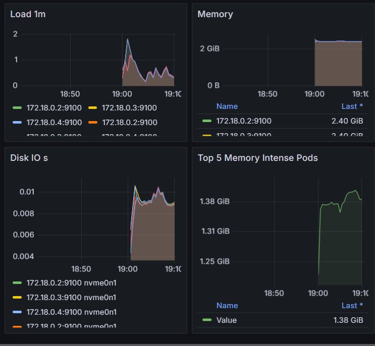

<div align="center">

# 🔭 Overwatch

### Kubernetes Monitoring, Alerting & FinOps Platform on AWS

Watch a Kubernetes cluster, get alerted when something breaks, and see what it costs.
Deployed automatically with **Terraform** and **GitHub Actions**.

[](https://github.com/Shubhamx18/overwatch/actions/workflows/deploy.yml)


<br>


</div>

---

## Table of Contents

1. [Overview](#1-overview)
2. [How It Works](#2-how-it-works)
3. [What You Set Up vs What Is Automated](#3-what-you-set-up-vs-what-is-automated)
4. [Step-by-Step Setup](#4-step-by-step-setup)
5. [Verify Everything Works](#5-verify-everything-works)
6. [Project Tour (Screenshots)](#6-project-tour-screenshots)
7. [FinOps: Cost Intelligence](#7-finops-cost-intelligence)
8. [CI/CD Pipeline](#8-cicd-pipeline)
9. [Daily Operations](#9-daily-operations)
10. [Troubleshooting](#10-troubleshooting)
11. [Security Notes](#11-security-notes)
12. [Design Decisions](#12-design-decisions)
13. [Tech Stack and Project Structure](#13-tech-stack-and-project-structure)
14. [Glossary](#14-glossary)
15. [Roadmap](#15-roadmap)

---

## 1. Overview

### The problem

Servers and clusters fail quietly. Without monitoring, you hear about a crash from your users, and you learn about wasted cloud spend from the bill at the end of the month.

### What Overwatch does

Overwatch is a production-style **observability stack** that runs on a Kubernetes ([kind](https://kind.sigs.k8s.io/)) cluster on a single AWS EC2 server. It answers three questions:

| Question | Answered by |
|---|---|
| **Is my cluster healthy?** | Prometheus metrics, shown in Grafana dashboards |
| **Will I know when something breaks?** | Alertmanager, with routing, grouping and inhibition rules |
| **What is this costing me?** | A FinOps dashboard with utilization and EC2 cost projections |

Everything is code:

- **Terraform** creates the server and its firewall.
- **Kubernetes manifests** describe the whole monitoring stack.
- **GitHub Actions** validates, tests and deploys every push to `main`.

### Features

- **Cluster monitoring**: nodes, pods and Kubernetes objects scraped by Prometheus
- **Auto-provisioned dashboards**: Grafana loads the main dashboards on startup
- **Smart alerting**: Alertmanager routing and inhibition rules
- **Uptime and SSL checks**: websites probed with Blackbox Exporter
- **FinOps dashboard**: CPU, RAM and disk utilization plus EC2 cost projections
- **Infrastructure as Code**: EC2, security group and default VPC detection with Terraform
- **Zero-touch boot**: the server installs Docker, kind and kubectl, then deploys the stack by itself
- **CI/CD**: manifest validation, an integration test on a throwaway kind cluster, automatic deployment

---

## 2. How It Works

### Architecture

```
                         ┌─────────────────────────┐
   git push ───────────► │     GitHub Actions      │
                         │ validate → test → deploy│
                         └────────────┬────────────┘
                                      │ SSH
                                      ▼
┌──────────────────── AWS EC2 (t3.medium, ap-south-1) ─────────────────────┐
│                                                                          │
│  ┌──────────────────── kind Kubernetes cluster ──────────────────────┐  │
│  │                    namespace: monitoring                           │  │
│  │                                                                    │  │
│  │  Node Exporter ───────┐                                            │  │
│  │  kube-state-metrics ──┼──►  Prometheus  ──►  Grafana (dashboards)  │  │
│  │  Blackbox Exporter ───┘         │                                  │  │
│  │                                 ▼                                  │  │
│  │                           Alertmanager ──► notifications           │  │
│  └────────────────────────────────────────────────────────────────────┘  │
└──────────────────────────────────────────────────────────────────────────┘
        ▲
        │ created by
   Terraform (EC2 + Security Group)
```

### The data flow, step by step

1. **Terraform** creates the EC2 server and its firewall (security group).
2. On first boot, a **boot script** (EC2 user-data) installs Docker, kind and kubectl, clones this repo and creates the Kubernetes cluster.
3. The **exporters** expose metrics:
   - Node Exporter: machine metrics (CPU, RAM, disk, network)
   - kube-state-metrics: Kubernetes objects (pods, deployments, nodes)
   - Blackbox Exporter: URL and SSL probes
4. **Prometheus** scrapes every exporter on a schedule, stores the data, and evaluates alert and recording rules.
5. **Grafana** reads from Prometheus and draws the dashboards.
6. When a rule fires, **Alertmanager** groups, routes and sends the alert.
7. Every `git push` to `main` runs the **pipeline**, which redeploys the manifests to the server.

### Components

| Component | Role |
|---|---|
| **Prometheus** | Collects and stores metrics; evaluates alert and recording rules |
| **Grafana** | Dashboards for FinOps, nodes and the Kubernetes cluster |
| **Alertmanager** | Routes, groups and sends alerts |
| **Node Exporter** | Machine metrics, one pod per node (DaemonSet) |
| **kube-state-metrics** | Kubernetes object metrics (pods, deployments, nodes) |
| **Blackbox Exporter** | Probes URLs for uptime and SSL expiry |

> **Good to know:** the kind "nodes" (a control plane plus workers) are Docker containers on the one EC2 instance. Each Node Exporter therefore reports on the same underlying machine, which is why the nodes show near-identical memory and load in Grafana.

---

## 3. What You Set Up vs What Is Automated

This is the most important section. Read it first so there are no surprises.

### You do this manually (one time)

| # | Task | Where | Time |
|---|---|---|---|
| 1 | Create or use an **AWS account** | aws.amazon.com | 10 min |
| 2 | Create an **IAM user** and an **access key** (do not use the root account) | AWS Console → IAM | 5 min |
| 3 | Create an **EC2 key pair** in `ap-south-1` and save the `.pem` file | AWS Console → EC2 | 2 min |
| 4 | Install **Git, Terraform and AWS CLI** on your computer | Your machine | 10 min |
| 5 | Run `aws configure` with your access key | Your machine | 1 min |
| 6 | Put your **key pair name** in `terraform.tfvars` | Repo file | 1 min |
| 7 | Run `terraform init` and `terraform apply` | Your machine | 3 min |
| 8 | Log in to Grafana and **change the default password** | Browser | 2 min |
| 9 | *(Optional)* Import community dashboards | Grafana UI | 3 min |
| 10 | *(CI/CD only)* Add **4 GitHub secrets** and create the `production` environment | GitHub settings | 5 min |
| 11 | *(Recommended)* Tighten the security group | AWS Console or Terraform | 5 min |

### Overwatch does this for you

| Automated task | Done by |
|---|---|
| Find your default VPC and subnets | Terraform data sources |
| Create the EC2 instance and security group | Terraform |
| Install Docker, kind and kubectl | Boot script (user-data) |
| Clone the repo and create the kind cluster | Boot script |
| Deploy Prometheus, Grafana, Alertmanager and the exporters | Boot script (`kubectl apply`) |
| Load the FinOps and Node Exporter dashboards | Grafana provisioning |
| Compute cost and utilization metrics | Prometheus recording rules |
| Validate, test and deploy every push | GitHub Actions |

---

## 4. Step-by-Step Setup

Follow the phases in order. Each phase ends with a quick check, so you know it worked before moving on.

### Phase 1: Prepare your computer

Install these tools:

| Tool | Install guide | Check |
|---|---|---|
| Git | https://git-scm.com/downloads | `git --version` |
| Terraform | https://developer.hashicorp.com/terraform/install | `terraform -version` |
| AWS CLI v2 | https://aws.amazon.com/cli/ | `aws --version` |

You also need an SSH client. macOS, Linux and Windows 10/11 (PowerShell) include one.

### Phase 2: Prepare AWS

**2.1 Create an IAM user and access key**

1. AWS Console → **IAM** → **Users** → **Create user**.
2. Attach a policy. For a demo, `AmazonEC2FullAccess` is enough. Terraform needs to create instances and security groups and to read your VPC.
3. Open the new user → **Security credentials** → **Create access key** → use case **Command Line Interface (CLI)**.
4. Copy or download the **Access Key ID** and **Secret Access Key**. The secret is shown only once.

**2.2 Create an EC2 key pair**

1. Switch the console region (top right) to **Asia Pacific (Mumbai) `ap-south-1`**. Key pairs are regional, so a key made in another region will not work.
2. **EC2** → **Key Pairs** → **Create key pair**.
3. Name it (for example `overwatch-key`), choose type **RSA** and format **.pem**.
4. Save the downloaded file somewhere safe and lock its permissions:

```bash
# macOS / Linux
chmod 400 overwatch-key.pem
```

```powershell
# Windows PowerShell
icacls .\overwatch-key.pem /inheritance:r /grant:r "$($env:USERNAME):R"
```

**2.3 Confirm a default VPC exists**

Terraform auto-detects your default VPC. In **VPC** → **Your VPCs**, one should say **Default VPC: Yes**. If you deleted it, restore it with **Actions → Create default VPC**.

> ✅ **Check:** you have an access key pair, a `.pem` file, and a default VPC in `ap-south-1`.

### Phase 3: Connect your computer to AWS

```bash
aws configure
```

| Prompt | Value |
|---|---|
| AWS Access Key ID | your access key |
| AWS Secret Access Key | your secret key |
| Default region name | `ap-south-1` |
| Default output format | `json` |

Verify that it works:

```bash
aws sts get-caller-identity
```

> ✅ **Check:** this prints your account ID and the IAM user's ARN. An error means the keys are wrong.

### Phase 4: Get the code and set your key name

```bash
git clone https://github.com/Shubhamx18/overwatch.git
cd overwatch
```

Open `terraform-aws/prometheus-stack/terraform.tfvars` and set your key pair name (the name, not the file name, and no `.pem`):

```hcl
key_name = "overwatch-key"   # AWS Console → EC2 → Key Pairs
```

> **Using a fork?** The server's boot script clones the repo itself. If you fork Overwatch, update the repository URL inside the EC2 module's user-data script (`terraform-aws/modules/ec2/`) so the server pulls *your* fork.

### Phase 5: Create the server with Terraform

```bash
cd terraform-aws/prometheus-stack
terraform init       # downloads the AWS provider
terraform plan       # (optional) preview what will be created
terraform apply      # type "yes" when asked
```

Terraform creates an EC2 `t3.medium` instance in `ap-south-1` and a security group that opens ports 22, 3000, 9090, 9093 and 9115. When it finishes it prints:

```
ec2_public_ip = "X.X.X.X"
grafana_url   = "http://X.X.X.X:3000"
ssh_command   = "ssh -i <key>.pem ubuntu@X.X.X.X"
```

> **Save the IP.** You will need it for every tool, and again for the pipeline.
>
> **Keep the `terraform.tfstate` file.** It is Terraform's memory of what it created. If you lose it, Terraform can no longer manage or destroy your resources. (Remote state in S3 is on the roadmap.)

### Phase 6: Wait for the first boot (about 5 minutes)

The server now sets itself up. You do not need to do anything, but you can watch:

```bash
ssh -i overwatch-key.pem ubuntu@<EC2-IP> "tail -f /var/log/monitoring-setup.log"
```

The boot script:

1. Installs Docker, kind and kubectl
2. Clones this repository
3. Creates the kind cluster
4. Deploys all monitoring components

When it is done:

```bash
ssh -i overwatch-key.pem ubuntu@<EC2-IP> \
  "export KUBECONFIG=/home/ubuntu/.kube/config && kubectl get pods -n monitoring"
```

> ✅ **Check:** you see **8 pods `Running`**: alertmanager, blackbox-exporter, grafana, kube-state-metrics, prometheus, and one node-exporter on each of the 3 nodes.

### Phase 7: Open the tools

Use `http://` (not `https://`) and replace `<EC2-IP>` with your server's IP.

| Tool | URL | What to check |
|---|---|---|
| **Grafana** | `http://<EC2-IP>:3000` | Dashboards |
| **Prometheus** | `http://<EC2-IP>:9090` | `/targets` should show everything **UP** |
| **Alertmanager** | `http://<EC2-IP>:9093` | Status page shows **ready**; active and silenced alerts |
| **Blackbox Exporter** | `http://<EC2-IP>:9115` | Probe results |

### Phase 8: First login to Grafana

1. Open `http://<EC2-IP>:3000`.
2. Log in with the credentials defined in the Grafana manifest under `k8s/grafana/`.
3. **Change the password immediately** (profile icon → Profile → Change password).
4. Open **Dashboards**. These two load automatically:
   - **FinOps: Cost Intelligence**
   - **Node Exporter**

**Optional: import community dashboards**

Go to **Dashboards → New → Import**, type the ID, click **Load**, choose the **Prometheus** data source, click **Import**.

| ID | Dashboard |
|---|---|
| `1860` | Node Exporter Full |
| `7249` | Kubernetes Cluster |
| `13332` | kube-state-metrics |

> **Tip:** if an imported dashboard shows "No data", look at the dropdowns at the top (Job, Instance, Nodename, cluster) and pick a value. The Node Exporter dashboards in the screenshots use **Job: `kubernetes-pods`**. A `cluster: None` dropdown on the Kubernetes dashboard is normal for a single cluster.

### Phase 9: Set up the CI/CD pipeline (optional but recommended)

With this, every `git push` redeploys automatically. Skip it if you only want to run the stack once.

**9.1 Use your own GitHub repository.** Fork this repo, or push your copy to a new repo. Secrets are stored per repository.

**9.2 Add repository secrets** at *Settings → Secrets and variables → Actions → New repository secret*:

| Secret | Value |
|---|---|
| `PROD_SERVER_IP` | The EC2 public IP from Phase 5 |
| `PROD_SSH_KEY` | The **entire contents** of your `.pem` file, including the `-----BEGIN` and `-----END` lines |
| `AWS_ACCESS_KEY_ID` | Your AWS access key |
| `AWS_SECRET_ACCESS_KEY` | Your AWS secret key |

To print the key for copying: `cat overwatch-key.pem` (macOS/Linux) or `Get-Content .\overwatch-key.pem` (PowerShell).

**9.3 Create the environment** at *Settings → Environments → New environment*, named exactly `production`.

**9.4 Push a change**

```bash
git add .
git commit -m "first pipeline run"
git push origin main
```

> ✅ **Check:** open the **Actions** tab. Three stages should turn green: Validate → Integration Test → Deploy.

### Phase 10: Lock it down

Do this before leaving the stack running. See [Security Notes](#11-security-notes), especially the SSH note about the pipeline.

---

## 5. Verify Everything Works

Use this checklist after setup.

| Check | How | Expected |
|---|---|---|
| Server is up | EC2 Console | State **Running** |
| Pods healthy | `kubectl get pods -n monitoring` | 8 pods `Running` |
| Metrics collected | Prometheus → **Status → Targets** | All targets **UP** |
| Dashboards load | Grafana → Dashboards | FinOps and Node Exporter show data |
| Alerting ready | Alertmanager → **Status** | Cluster status **ready** |
| Pipeline works | GitHub → Actions | Three green stages |

**Send a test alert** to prove Alertmanager receives alerts:

```bash
curl -XPOST http://<EC2-IP>:9093/api/v2/alerts \
  -H 'Content-Type: application/json' \
  -d '[{"labels":{"alertname":"TestAlert","severity":"warning"}}]'
```

Refresh the Alertmanager page. `TestAlert` should appear. Until you configure a receiver (Slack or email, see the [Roadmap](#15-roadmap)), alerts show up in the UI but are not sent anywhere else.

---

## 6. Project Tour (Screenshots)

This is what the running stack looks like, in the order data flows through it: server, alerting, cluster, node, cost, workload.

### Step 1: The server (AWS EC2)

Terraform creates a `t3.medium` instance in `ap-south-1` inside the default VPC. Everything below runs on this one machine.


### Step 2: Alerting (Alertmanager)

Alertmanager reports `ready`. This is where Prometheus sends alerts, so you hear about problems before your users do.


### Step 3: The whole cluster (Grafana)

The big picture: how much of the cluster's pod, CPU and memory capacity is already requested by workloads. This is the starting point for right-sizing decisions.


### Step 4: One node up close (Node Exporter)

A single node at a glance: CPU busy, system load, RAM and swap used, pressure, plus core count, total RAM and uptime.


### Step 5: Resource utilization (FinOps dashboard)

Load, memory, disk I/O and the most memory-hungry pods, with trends over time. Low usage next to a steady cost is how you spot over-provisioned resources.



### Step 6: The workloads (pod and node health)

Are the pods healthy? Running count, restarts, CPU idle and node storage at a glance.


> **Reading the screenshots:** the cluster, node, cost and pod views are all driven by the same Prometheus data. Only the zoom level changes.

---

## 7. FinOps: Cost Intelligence

Overwatch turns monitoring data into cost visibility. Prometheus **recording rules** pre-compute these metrics every 15 seconds so dashboards load instantly:

| Metric | Meaning |
|---|---|
| `finops:cpu_utilization_24h` | Current CPU usage % |
| `finops:ram_utilization_24h` | Current RAM usage % |
| `finops:disk_utilization` | Current disk usage % |
| `finops:total_ram_gb` | Total RAM in GB |
| `finops:ec2_hourly_cost_usd` | EC2 cost per hour (t3.medium, ap-south-1) |
| `finops:ec2_session_cost_usd` | Cost since the instance booted |
| `finops:ec2_daily_cost_usd` | Projected daily cost |
| `finops:ec2_monthly_cost_usd` | Projected monthly cost |

**How to read it:** low utilization next to a steady cost means a resource is over-provisioned and can be right-sized. That gap is where the savings are.

> The cost metrics use a fixed hourly price for `t3.medium` in `ap-south-1`. If you change the instance type or region, update the price in the recording rules under `k8s/prometheus/`.

---

## 8. CI/CD Pipeline

Every push to `main` runs three stages, defined in `.github/workflows/deploy.yml`:

```
  push to main
       │
       ▼
┌─────────────┐    ┌──────────────────┐    ┌─────────────┐
│ 1. Validate │ ─► │ 2. Integration   │ ─► │ 3. Deploy   │
│ kubeconform │    │    Test (kind)   │    │ SSH → EC2   │
│   ~1 min    │    │     ~5 min       │    │   ~1 min    │
└─────────────┘    └──────────────────┘    └─────────────┘
```

| Stage | What it does |
|---|---|
| **1. Validate** | Checks every Kubernetes manifest with `kubeconform` |
| **2. Integration Test** | Spins up a temporary kind cluster, deploys all components, and checks that Prometheus and Grafana are healthy |
| **3. Deploy** | SSHes into EC2, runs `git pull` and `kubectl apply --server-side` |

A failing stage stops the pipeline, so a broken manifest never reaches your server. Setup steps are in [Phase 9](#phase-9-set-up-the-cicd-pipeline-optional-but-recommended).

### After a Prometheus config change

`kubectl apply` updates the ConfigMap, but Prometheus only reads its config at startup. Restart it to pick up new alert rules, recording rules and scrape configs:

```bash
ssh -i <key>.pem ubuntu@<EC2-IP> \
  "export KUBECONFIG=/home/ubuntu/.kube/config && \
   kubectl rollout restart deployment prometheus grafana -n monitoring"
```

---

## 9. Daily Operations

**EC2 IP changed after a stop/start?** A normal public IP changes whenever the instance is stopped and started.

```bash
cd terraform-aws/prometheus-stack
terraform output ec2_public_ip      # get the new IP
# then update the PROD_SERVER_IP GitHub secret
```

For a permanent IP, allocate an **Elastic IP** (AWS Console → EC2 → Elastic IPs) and associate it with the instance. AWS charges for public IPv4 addresses.

**Restart a component**

```bash
ssh -i <key>.pem ubuntu@<EC2-IP> \
  "export KUBECONFIG=/home/ubuntu/.kube/config && \
   kubectl rollout restart deployment prometheus -n monitoring"
```

**Stop paying: destroy everything**

```bash
cd terraform-aws/prometheus-stack
terraform destroy      # type "yes"
```

**Bring it back**

```bash
terraform apply        # then wait about 5 minutes for the boot script
```

> A running EC2 instance is billed by the hour. Run `terraform destroy` when you are done experimenting, and confirm in the EC2 console that nothing is left running.

### Quick reference

| What | Command / URL |
|---|---|
| SSH into EC2 | `ssh -i <key>.pem ubuntu@<EC2-IP>` |
| Check pods | `kubectl get pods -n monitoring` |
| Prometheus targets | `http://<EC2-IP>:9090/targets` |
| Boot log | `tail -f /var/log/monitoring-setup.log` |
| Create / destroy EC2 | `terraform apply` / `terraform destroy` |
| Deploy changes | `git push origin main` |
| Get EC2 IP | `terraform output ec2_public_ip` |

---

## 10. Troubleshooting

### During setup

| Problem | Likely cause and fix |
|---|---|
| `aws sts get-caller-identity` fails | Wrong or missing keys. Re-run `aws configure` |
| `terraform apply`: `InvalidKeyPair.NotFound` | `key_name` is misspelled, includes `.pem`, or the key was created in a different region than `ap-south-1` |
| `terraform apply`: `UnauthorizedOperation` | The IAM user lacks EC2 permissions. Attach `AmazonEC2FullAccess` |
| Terraform cannot find a VPC or subnet | No default VPC. Create one: VPC console → Actions → Create default VPC |
| `ssh`: `Permission denied (publickey)` | Wrong key, wrong user (it is `ubuntu`), or loose file permissions (`chmod 400`) |
| `ssh` times out | The instance is still starting, the IP changed, or port 22 is blocked in the security group |

### After setup

| Problem | Likely cause and fix |
|---|---|
| Browser shows `ERR_CONNECTION_TIMED_OUT` | The IP changed after a stop/start, an inbound rule is missing in the security group, you used `https://`, or the boot script is still running |
| Pods not ready | Check `tail -f /var/log/monitoring-setup.log` on the server. Pods stuck `Pending` can mean the t3.medium is out of memory |
| Prometheus targets show 403 | Make sure `k8s/prometheus/kubelet-rbac.yaml` is applied |
| Grafana panel says "No data" | Check the dropdowns (Job, Instance, Nodename) at the top of the dashboard, and confirm the target is **UP** in Prometheus |
| Dashboard not updating after a config change | Restart Prometheus and Grafana (see [CI/CD](#after-a-prometheus-config-change)) |
| Pipeline deploy: `Permission denied (publickey)` | `PROD_SSH_KEY` is incomplete. Paste the whole file, including the `BEGIN` and `END` lines |
| Pipeline deploy cannot connect | `PROD_SERVER_IP` is outdated, or port 22 no longer allows GitHub's runners (see below) |

---

## 11. Security Notes

| Port | Service |
|---|---|
| 22 | SSH |
| 3000 | Grafana |
| 9090 | Prometheus |
| 9093 | Alertmanager |
| 9115 | Blackbox Exporter |

- The security group rules default to `0.0.0.0/0` (open to the internet) for easy testing. Prometheus, Alertmanager and Blackbox have **no login**, so for anything beyond a demo, restrict ports 9090, 9093 and 9115 to your own IP (find it with `curl ifconfig.io`).
- **A caution about SSH:** the deploy stage connects from GitHub-hosted runners, whose IPs change constantly. If you restrict port 22 to your IP only, the Deploy stage will fail. Choose one: keep port 22 open with key-only login, use a self-hosted runner, or deploy through AWS Systems Manager.
- Change the default Grafana password after the first login.
- Never commit your `.pem` key or AWS credentials. Secrets belong in GitHub Actions secrets.
- Prefer a dedicated IAM user with limited permissions, and rotate its keys regularly.

---

## 12. Design Decisions

**Grafana dashboards are auto-provisioned.** The dashboard JSON lives in a ConfigMap, is mounted into the Grafana pod, and a provider ConfigMap tells Grafana to load it on startup. No manual import is needed for the main dashboards.

**`kubectl apply --server-side` everywhere.** The Node Exporter dashboard JSON is about 300 KB. A normal `kubectl apply` stores the full config in an annotation, which has a 262 KB limit and fails. Server-side apply has no such limit.

**Default VPC auto-detection.** Terraform finds your default VPC and subnets with data sources, so there are no hardcoded IDs.

**Prometheus kubelet RBAC fix.** `k8s/prometheus/kubelet-rbac.yaml` grants Prometheus access to kubelet metrics. Without it, the `kubernetes-nodes` and `kubernetes-cadvisor` targets return 403.

**Different ports locally and on EC2.** The local kind config (`kind-cluster.yaml`) uses Grafana `13000` and Prometheus `19090` to avoid port conflicts. The EC2 config (`kind-cluster-ec2.yaml`) uses the standard `3000` and `9090`.

**Recording rules for FinOps.** Cost and utilization are pre-computed by Prometheus every 15 seconds, so dashboards read a ready-made number instead of running a heavy query on every refresh.

---

## 13. Tech Stack and Project Structure

| Area | Tools |
|---|---|
| **Monitoring** | Prometheus, Node Exporter, kube-state-metrics, Blackbox Exporter |
| **Visualization** | Grafana |
| **Alerting** | Alertmanager |
| **Orchestration** | Kubernetes (kind), kubectl |
| **Infrastructure** | Terraform, AWS EC2, Security Groups |
| **CI/CD** | GitHub Actions, kubeconform |

```
overwatch/
├── .github/workflows/
│   └── deploy.yml              # CI/CD pipeline
├── assets/                     # Screenshots used in this README
├── k8s/
│   ├── kind/                   # kind cluster configs (local and EC2)
│   ├── namespace/              # monitoring namespace
│   ├── prometheus/             # Prometheus, alert rules, FinOps recording rules, kubelet RBAC
│   ├── alertmanager/           # Alertmanager config and routing
│   ├── grafana/                # Grafana + auto-provisioned dashboards
│   ├── node-exporter/          # DaemonSet on every node
│   ├── kube-state-metrics/     # Kubernetes object metrics + RBAC
│   └── blackbox-exporter/      # URL and SSL probing
├── terraform-aws/
│   ├── modules/
│   │   ├── ec2/                # EC2 instance + user-data boot script
│   │   └── security-group/     # Firewall rules
│   └── prometheus-stack/       # Main Terraform config and variables
├── Makefile
├── .env.example
└── README.md
```

---

## 14. Glossary

| Term | Plain-English meaning |
|---|---|
| **Observability** | Being able to see what is happening inside your systems |
| **Metric** | A number measured over time, such as CPU usage |
| **Exporter** | A small program that exposes metrics for Prometheus to collect |
| **Scrape** | Prometheus visiting an exporter to read its current numbers |
| **Recording rule** | A saved calculation that Prometheus runs ahead of time |
| **Alert rule** | A condition (for example, "CPU above 90% for 5 minutes") that triggers an alert |
| **Inhibition** | Muting a minor alert when a bigger one already explains it |
| **kind** | "Kubernetes in Docker": a Kubernetes cluster that runs inside containers |
| **Manifest** | A YAML file that describes something to run in Kubernetes |
| **ConfigMap** | A Kubernetes object that holds configuration files |
| **DaemonSet** | A Kubernetes workload that runs one pod on every node |
| **Terraform** | A tool that creates cloud resources from code |
| **user-data** | A script AWS runs automatically the first time an EC2 instance boots |
| **FinOps** | Managing cloud cost by tracking usage against spend |

---

## 15. Roadmap

- [ ] Elastic IP managed by Terraform
- [ ] Switch AWS credentials to GitHub OIDC (no stored keys)
- [ ] Slack or email alert notifications
- [ ] Per-container metrics with cAdvisor
- [ ] Remote Terraform state in S3

---

<div align="center">

**Built by [Shubham](https://github.com/Shubhamx18)**

If this project helped you, consider giving it a ⭐

</div>
